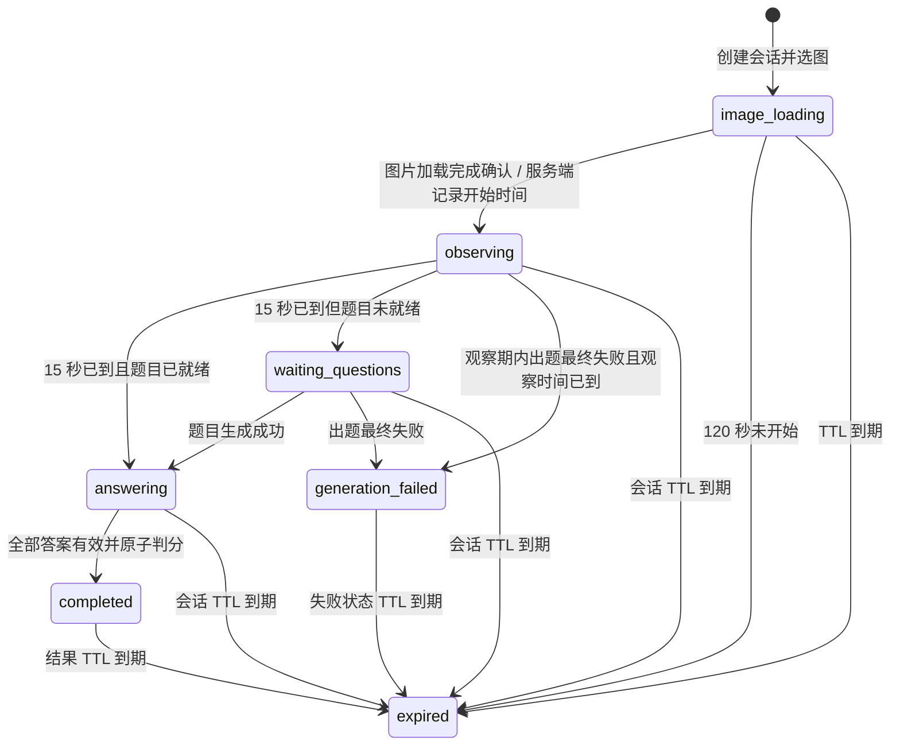
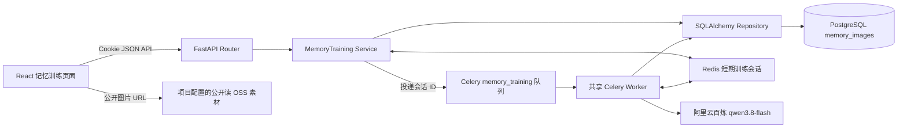
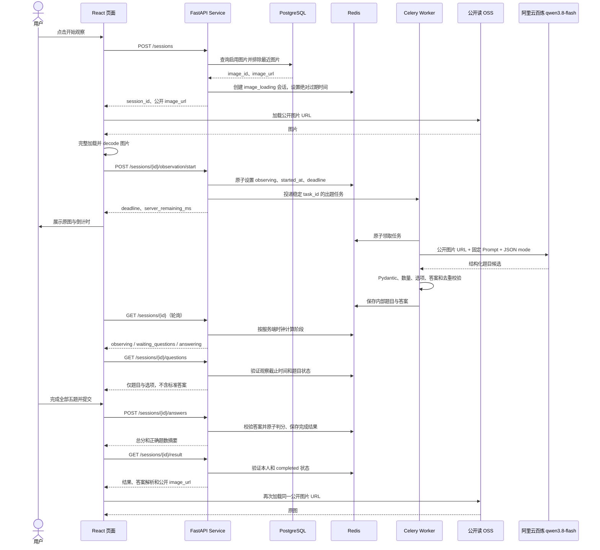

# 记忆训练工具——需求与实现设计

> 文档日期：2026-10-28  
> 文档状态：首版实现已落地（2026-10-29）
> 工具名称：记忆训练  
> 技能代码建议：`memory_training`  
> 技能类型：`tool`

本文记录“记忆训练”的需求、实现约束和首版落地情况。后续确认已覆盖早期设计中关于私有 OSS 代理、`memory_images` 字段及图片接口的设想；应以本文件第 1.3、7、9、10、15 和 19 节的已确认实现为准。

## 1. 需求背景

### 1.1 目标

在技能市场增加一个名为“记忆训练”的工具。用户观察一张图片 15 秒，然后完成 5 道由视觉模型根据该图片生成的单选题。后端使用模型生成并保存于短期会话状态中的标准答案确定性判分，每题 20 分，最高 100 分。提交后展示成绩、逐题解析和本次训练使用的原图。

### 1.2 仓库现状与设计依据

| 领域 | 已核实的项目事实 | 对本方案的影响 |
|---|---|---|
| 技能市场 | `skills` 表使用 `agent`、`tool` 类型；`user_skills` 保存用户添加关系；技能由 `skills` 模块的 Router、Service、Repository 管理。应用生命周期通过幂等函数注册内建技能。 | 复用既有技能目录及用户添加流程；只增加一个 `tool` 目录项，不新建技能表。 |
| 工具入口 | “我的技能”使用 `skillUsage.ts` 根据技能代码分派运行入口；提醒工具已有独立页面入口。前端由 `App.tsx` 和 `platformData.ts` 管理页面路径，没有使用 React Router。 | 为 `memory_training` 增加一个独立页面路径和运行分派，不新增全局导航项。 |
| 后端模块 | 技能、提醒、简历等模块遵循 Router、Service、Repository 分层；依赖使用 FastAPI `Depends` 注入当前用户和数据库会话。 | 新建独立 `memory_training` 业务模块，Router 不承载业务逻辑。 |
| 认证与错误 | 登录态为 HttpOnly Cookie；`get_current_user` 从会话恢复当前用户；状态变更路由可复用 `validate_origin`；现有业务异常通常映射为 `{"detail":"..."}`。 | 所有训练接口要求登录并按当前用户隔离；状态变更继续做来源校验。新模块建议在不改变既有 API 的前提下同时返回稳定业务码。 |
| 数据库 | SQLAlchemy 2 同步 `Session`、PostgreSQL、Alembic；业务表主键普遍使用应用生成的 Snowflake BIGINT，响应中转成十进制字符串；时间用带时区 `DateTime`。 | 图片目录表按现有模型和迁移模式实现。训练过程不新增持久化历史表。 |
| Redis 与任务 | `redis` 客户端是同步客户端；Celery 使用同一 Redis broker，提醒任务采用迟确认和 Worker 丢失重投；Celery 无结果后端。 | 新增模块专属 Redis 状态仓储；出题任务复用 Celery 基础设施并投递独立队列，由现有后台 Worker 共同消费。Worker 使用 `solo` 池，模型调用期间提醒任务可能排队。 |
| 模型 | 平台默认模型由 `OpenAICompatibleChatModelProvider` 按 DeepSeek 配置创建。 | 记忆训练出题单独使用阿里云百炼配置，避免改变平台其他模型调用；通过 OpenAI-compatible 多模态消息传递 OSS 图片公开 URL。 |
| OSS | `AliyunOSSObjectStorage` 支持对象上传、公有读 ACL 和公开 URL 构造。 | 训练图由管理员上传到项目配置的 OSS；数据库记录公开访问 URL，浏览器和模型均使用该 URL。 |
| 前端 UI | 已有 `UI_DESIGN.md`、全局主题令牌、`.button` 变体、`PlatformLayout`、`PlatformIcon`、`ToastProvider` 和安全错误文案工具。 | 沿用浅色中性底色、克制品牌蓝、现有按钮和通知；不改变全局导航结构。 |

关键代码依据：[技能模型](../../backend/app/modules/skills/models.py)、[技能注册与仓储](../../backend/app/modules/skills/repository.py)、[技能入口分派](../../frontend/src/features/platform/skillUsage.ts)、[应用路由](../../frontend/src/app/App.tsx)、[模型 Provider](../../backend/app/infrastructure/llm/provider.py)、[OSS 适配器](../../backend/app/infrastructure/storage/aliyun_oss.py)、[Celery 配置](../../backend/app/core/celery_app.py)、[前端设计规范](../design/UI_DESIGN.md)。

### 1.3 已确认的图片维护方式

首版由管理员人工将图片上传到项目配置的 OSS，并维护 `memory_images` 记录；首版不开发图片管理 API 或后台页面。素材按 `memory-training-0001.png` 形式顺序命名，存放于 `memory-training/` 路径；数据库保存图片公开访问 URL。图片需有合法使用权、不含敏感个人信息，并满足当前模型服务的数据处理要求。训练图片不接受普通用户上传。

### 1.4 已确认的实现约束

- **已确认：** 技能代码为 `memory_training`，技能名称为“记忆训练”，技能类型为 `tool`。
- **已确认：** 记忆训练的图片理解与题目生成使用阿里云百炼 `qwen3.8-flash`，读取 `ALIYUN_BAILIAN_API_KEY`、`ALIYUN_BAILIAN_BASE_URL`、`ALIYUN_BAILIAN_MODEL`；不改变平台默认 DeepSeek 配置。
- **设计建议：** 图片格式仅支持 JPEG、PNG；由管理员预处理并限制尺寸和大小，建议单张不超过 8 MiB、最长边不超过 2048 像素，以控制加载和模型成本。不要为了此功能未经评估地增加图像处理依赖。

## 2. 产品目标与非目标

### 2.1 产品目标

1. 用户可从“我的技能”启动独立的“记忆训练”工具。
2. 训练图片在训练准备阶段不展示；图片加载完成后，服务端记录 15 秒观察窗口。
3. 图片观察期间并行生成 5 道单选题，不让模型耗时延长观察窗口。
4. 观察结束且题目可用后，用户逐题作答，可返回修改；全部答完才可提交。
5. 后端按模型生成并保存在服务端的答案判分；重复提交结果稳定。
6. 结果页显示本次原图、成绩、用户答案、正确答案和解析；结果可刷新恢复，保留到会话过期。
7. 用户可开始新会话；尽量避免连续抽到同一张图。

### 2.2 非目标

- 不实现 Agent、LangGraph 状态图、多智能体或对话历史。
- 不将用户训练历史、题目、作答或成绩写入 PostgreSQL。
- 不在前端判分，不接受客户端传入的分数或正确答案。
- 不实现图片上传、题库管理 UI、管理权限体系或永久图片使用历史。
- 不限制用户答题耗时；训练会话本身有服务端有效期。
- 不承诺模型可以避免所有视觉识别错误，也不提供能力测评或医疗结论。

## 3. 功能需求与用户流程

### 3.1 进入准备页

用户从“我的技能”选择“记忆训练”。服务端检查当前用户已经添加该技能且技能仍发布。准备页显示名称、介绍、训练规则、`15 秒`、`5 道题`、`100 分`和“开始观察”。页面不得提前拿到训练图像 URL、Object Key 或图片内容。

### 3.2 创建会话及加载图片

点击“开始观察”后，前端请求新会话。服务端随机抽取一张启用图片，创建 Redis 会话并返回会话 ID 与该图片的 OSS 公开访问 URL。前端加载并解码图片；加载成功后发起“开始观察”请求。该确认到达服务端时记录 `observation_started_at` 和 `observation_deadline_at = started_at + 15 秒`，并投递出题任务。前端收到成功响应后展示图片和倒计时。

如果图片加载失败，观察计时和模型调用都不开始。前端允许重新加载同一会话图片；会话 `image_loading` 阶段最多等待 120 秒，超时后需要新建训练。

### 3.3 观察与并行出题

观察期间前端展示完整图片、简洁观察提示、15 秒倒计时与进度条。图片使用 `object-fit: contain`，布局预留固定空间。倒计时只用于显示；服务端时间戳是权威时钟。用户切换标签页、刷新或设备休眠不暂停服务端时间。

服务端在确认开始后投递一个 Celery 出题任务。任务读取 Redis 会话中的图片公开 URL，将图片 URL 与提示词一起交给阿里云百炼 `qwen3.8-flash`，校验并保存题目和标准答案到同一个 Redis 训练会话。观察结束后前端隐藏图片。

### 3.4 观察结束及等待

15 秒到期后，前端立即隐藏观察图片并查询会话状态。服务端在状态查询和取题时独立校验 `now >= observation_deadline_at`，不依赖前端倒计时。OSS 链接本身为公开链接，服务端不会代理或撤销对图片的访问。

- 题目已生成：状态进入 `answering`，前端取题并开始答题。
- 题目仍在生成：状态进入 `waiting_questions`，显示“正在准备记忆测试 / 正在根据刚才的图片生成 5 道题目，请稍候。”图片保持隐藏。
- 出题最终失败：返回失败状态和安全提示；提供“重新开始”，创建新会话并重新抽图。生成失败时不开放题目，也不允许继续提交。

### 3.5 答题与提交

一次显示一道题，顶部显示第几题和进度。每题 4 个单选选项；提供上一题、下一题；最后一题显示“提交答案”。允许返回修改；选中项有清楚但克制的品牌色反馈。提交前不展示正确答案、答案解析或任何包含正确答案的模型原始字段。

前端将会话 ID 和未提交的选项草稿保存在当前标签页的 `sessionStorage`，便于刷新恢复；此草稿只用于 UI 恢复，服务端只接受最终提交并重新校验选项。后端要求答案题目 ID 集合恰好等于 5 个题目 ID，且每个选项 ID 都属于该题。未答全返回 422。

### 3.6 判分与结果

服务端在一次原子状态转换中保存用户最终答案、逐题得分、正确题数、总分和完成时间。正确得 20 分，错误得 0 分；重复提交相同答案返回相同结果，提交不同答案返回 409。评分只比较服务端私有标准答案，不再次调用模型。

结果页显示总分、正确题数、错误题数、正确率；展示本次同一张原图，支持查看；展示五道题的答案解析。卡片显示题目、用户答案、正确答案和解析。提供“再来一次”和“返回技能市场”。结果图片使用同一会话保存的 OSS 公开 URL；停用图片不影响已完成会话中的结果链接。

“再来一次”创建新的训练会话，不复用旧题目或答案。若启用图片池中有多于一张图，则优先排除当前用户最近一次选中的图片；最近使用标记只在 Redis 保存短期，不形成永久历史。

## 4. 会话状态机



| 状态 | 服务端含义 | 允许操作 |
|---|---|---|
| `image_loading` | 已分配图片，尚未开始观察。 | 当前用户读取图片、重试加载、确认开始。 |
| `observing` | 已记录服务器开始时间，15 秒窗口内。 | 查询剩余时间；读取图片仅至截止时刻；重复 start 返回同一截止时间；取题一律拒绝。 |
| `waiting_questions` | 观察已结束，模型仍在生成。 | 查询状态、重复查询题目状态；图片不可读。 |
| `answering` | 观察已结束，5 道题校验通过。 | 读取不带答案的题目、提交完整作答。 |
| `completed` | 最终答案与评分已保存。 | 读取结果和本次原图；相同答案重复提交返回原结果。 |
| `generation_failed` | 自动重试后仍无法生成可信格式的 5 道题。 | 查看安全错误状态；开始新训练。 |
| `expired` | Redis TTL 已到期或业务读取判定绝对有效期结束。 | 不允许恢复；前端提示训练已过期并开始新训练。 |

模型任务只在会话有效且题目尚未保存时写回。Redis `WATCH/MULTI` 保护状态修改和最终判分。重复队列投递可能造成模型重复调用，但已保存题目不会被覆盖；首版不使用任务租约或稳定任务 ID。

## 5. 技术架构



Router 只做请求校验、认证依赖和响应组织。Service 管理技能权限、图片会话创建、服务器时间门槛、状态流转、任务投递和评分。Repository 只读 `memory_images`。Redis 状态仓储处理 JSON 状态、TTL 和基于 WATCH/MULTI 的状态修改。Celery Task 负责组装 Generator 并执行模型调用，不在 Task 中实现请求业务。Generator 通过现有模型 Provider 发送多模态消息（文本提示词和 OSS 图片 URL），使用 Pydantic 校验后返回内部题目对象。

不使用 Agent Runtime、LangGraph 或 SSE。出题是一个短生命周期后台任务，前端用状态轮询即可。

## 6. 训练时序



## 7. 数据库设计

### 7.1 表数量与字段

只增加一张业务表 `memory_images`，仅管理图片元数据。技能本身继续写入既有 `skills` 表；训练会话、题目、答案和结果都只保存在 Redis。首版迁移为 `0015_create_memory_images.py`。

| 字段 | PostgreSQL 类型 | 空值 | 约束 / 默认 | 用途 |
|---|---|---:|---|---|
| `id` | `BIGINT` | 否 | 应用生成 Snowflake 主键 | 图片 ID；对外不必暴露。ORM 测试可沿用 `BigInteger().with_variant(Integer(), "sqlite")`。 |
| `image_url` | `VARCHAR(2048)` | 否 | 唯一、非空 | 图片在项目 OSS 中的公开访问链接。 |
| `enabled` | `BOOLEAN` | 否 | `DEFAULT TRUE` | 是否可用于新会话。读取结果图不受此标志影响。 |
| `created_at` | `TIMESTAMPTZ` | 否 | `DEFAULT now()` | 图片登记时间。 |

表只保存训练必须的数据：`id`、`image_url`、`enabled`、`created_at`。不保存 `content_type`、`file_size_bytes`、对象键、原始文件名、更新时间或训练历史。图片公开链接唯一，启用状态决定是否能被新会话抽中。

推荐索引：主键自带 `id` 索引；`image_url` 唯一索引防止重复登记；部分索引 `CREATE INDEX ix_memory_images_enabled_id ON memory_images (id) WHERE enabled IS TRUE`，服务于启用图片查询。首版不创建额外统计、标签或用户历史索引。

### 7.2 随机抽图与增长

首版用 `WHERE enabled IS TRUE ORDER BY random() LIMIT 1`，过滤发生在随机排序之前，不会抽到停用记录。对于几十到几百张的小型管理题库，该查询简单易懂；即使有部分索引，`random()` 排序仍需扫描候选集，不应声称其随题库规模线性扩展。

达到数万张或查询成为热点后，先测量实际计划和延迟；可在 Redis 缓存启用图片 ID 列表并均匀随机选取，按短 TTL 刷新，选中后仍由数据库复核 `enabled`。管理员维护方式需触发缓存失效或接受短暂刷新延迟。不要以 `TABLESAMPLE` 作为小题库唯一方案，因为小样本可能为空且抽样偏差明显。最近图片排除后若候选集为空，则允许重复。

### 7.3 OSS 对象维护

管理员使用 `backend/app/scripts/upload_memory_images.py` 将素材上传至当前配置的 OSS。脚本按文件名排序，使用 `memory-training-0001.png` 到 `memory-training-0005.png` 这样的统一对象名，放在 `memory-training/` 路径并设置公开读 ACL；随后幂等登记公开 URL。若同名 OSS 对象内容不同，脚本拒绝覆盖。停用只阻止新会话抽取，不删除对象。由于链接公开，任何持有链接的人都能读取图片；只应使用已获授权且适合公开访问、适合发送给模型的素材。

## 8. Redis 会话设计

### 8.1 Key 与 TTL

| Key | 数据 | TTL / 用途 |
|---|---|---|
| `orionai:memory-training:session:{session_id}` | 一个 JSON 会话对象 | 创建时设定固定绝对上限 2 小时；活跃查询不无限续期。完成时重设为完成后 24 小时。 |
| `orionai:memory-training:last-image:{user_id}` | 最近抽到的图片 ID | 6 小时；仅用于降低连续重复，不是永久历史。 |

推荐 ID 以十进制字符串存储和传输，避免 JavaScript 对 BIGINT 的精度损失。当前仅创建会话和最近图片标记两个 Redis Key，不保存 OSS 凭据或模型密钥。

### 8.2 会话 JSON 示例

```json
{
  "schema_version": 1,
  "session_id": "784029123456789012",
  "user_id": "784029123456789001",
  "image_url": "https://oss.example.com/memory-training/memory-training-0001.png",
  "state": "observing",
  "observation_started_at": "2026-10-28T02:00:08Z",
  "observation_deadline_at": "2026-10-28T02:00:23Z",
  "questions": [],
  "generation_error_code": null,
  "answers": null,
  "score": null,
  "correct_count": null,
  "completed_at": null
}
```

`questions` 仅在模型输出通过完整校验后写入，内部每题包括 `id`、`prompt`、四个 `{id,text}` 选项、`correct_option_id` 和 `explanation`。同一 Redis 会话中的答案是私有状态。任何公开响应必须通过独立 DTO 投影，不能将内部 JSON 原样返回。会话直接保存本次图片公开 URL，避免为短期训练重复保存图片 ID 和对象键。

### 8.3 一致性、刷新和失败恢复

- 所有实例通过共享 Redis 状态和原子 CAS/Lua 修改同一会话；不得使用进程内字典作为状态源。
- 状态查询根据 Redis 内记录的 UTC 时间与服务端当前时间计算阶段。若处于 `observing` 且截止时间已到，原子转成 `answering`、`waiting_questions` 或 `generation_failed`。
- 创建接口不接受幂等键。每次用户主动开始都会创建新会话。
- 重复 observation/start 返回第一次记录的时间，不再投递新任务。队列投递失败会进入安全失败状态。
- Worker 任务检查会话状态，题目只接受首次成功写入。Celery 限制模型调用重试次数；重复投递仍可能触发并行模型调用，但后续写入不能覆盖已保存题目。
- 用户刷新时从 `sessionStorage` 取会话 ID，重新请求状态；答题草稿从同一标签页的本地存储恢复，结果和权威答案从 Redis 读取。浏览器关闭后，用户仍可在会话有效期内从同一标签页会话恢复；新浏览器上下文没有本地 ID 时不提供训练历史列表。
- Redis Key 过期或 Redis 数据丢失时，服务端返回统一 404/410；不尝试从数据库恢复题目或成绩，因为这些数据按需求不持久化。前端提示“训练已过期，请重新开始”。Compose 已启用 Redis AOF，但 AOF 仍不能替代数据库历史；生产 Redis 应配置容量、淘汰策略和持久化监控。
- 模型任务执行时会话已经过期时，Worker 丢弃结果，不重建会话；结果不会写入用户历史。
- 图片准备阶段设 120 秒上限，观察和答题会话 2 小时后过期，完成结果保留 24 小时，最近图片标记保留 6 小时。

## 9. AI 出题方案

### 9.1 模型接入与图片输入

复用 `OpenAICompatibleChatModelProvider` 和 LangChain 调用方式，但为训练任务显式传入独立的阿里云百炼 API Key、Base URL 和模型名。当前配置使用 `qwen3.8-flash`，通过多模态 `HumanMessage` 传入公开 OSS 图片 URL 和文字提示词，并使用 JSON mode 与 Pydantic 做结构校验。平台其他功能继续使用原有 DeepSeek 配置。

模型从公开 URL 读取图片；Worker 不下载或转存图片字节。模型输入只含一张图片和一条任务指令，不传用户资料或历史会话。Generator 使用异步 `ainvoke`，Celery 同步任务入口通过 `asyncio.run` 等待结果。

### 9.2 Prompt 设计

系统指令核心内容建议如下：

```text
你是视觉记忆训练的出题器。只根据用户消息附带的这一张图片出题。
生成恰好 5 道简体中文单选题，每题恰好 4 个互不相同的选项，并且只有一个正确选项。
题目只询问图片直接可见、能明确辨认的颜色、数量、动作、位置、空间关系或细节。
不得使用常识补全图片中看不清或不存在的信息，不得询问图片以外的知识。
优先选择明显、稳定、可核对的事实；避免模糊、主观、歧义、重复或对细小像素过度敏感的题目。
答案解析用一句话指出图片中支持答案的可见证据，不添加推测。
严格按指定 JSON Schema 返回，不输出 Markdown、前言或其他文本。
```

用户消息可写“请观察图片并按 Schema 出题”。不要把选中答案暴露到前端；生成后标准答案只存 Redis 内部状态。

### 9.3 Schema 与 Pydantic 校验

建议模型结构化输出 Schema（`additionalProperties: false`）：

```json
{
  "type": "object",
  "required": ["questions"],
  "properties": {
    "questions": {
      "type": "array",
      "minItems": 5,
      "maxItems": 5,
      "items": {
        "type": "object",
        "required": ["prompt", "options", "correct_option_id", "explanation"],
        "properties": {
          "prompt": {"type": "string", "minLength": 4, "maxLength": 240},
          "options": {
            "type": "array",
            "minItems": 4,
            "maxItems": 4,
            "items": {"type": "string", "minLength": 1, "maxLength": 120}
          },
          "correct_option_id": {"type": "string", "enum": ["A", "B", "C", "D"]},
          "explanation": {"type": "string", "minLength": 4, "maxLength": 400}
        },
        "additionalProperties": false
      }
    }
  },
  "additionalProperties": false
}
```

Pydantic DTO 采用 `extra="forbid"`；外层验证恰好 5 题，内层恰好 4 个非空选项，答案标签属于 A-D，问题及选项经空白归一化后不重复，题干去重后不重复，解释非空。服务端生成 `q1`–`q5` 题目 ID 和选项 ID A-D；不信任模型返回的任意 ID。`correct_option_id` 是唯一的单值字段，因此无法表示多个答案；仍须验证其在四个选项中存在。校验失败时整组题目作废，不用不足 5 题的集合开始答题。

先使用目标 Provider 支持的 `with_structured_output` JSON Schema 模式；若其不支持，则要求 JSON mode 并对原始输出执行 `model_validate_json`。不能以 JSON 能解析代替业务校验。

### 9.4 去重、事实风险和失败策略

- 去重：在同一组题中对标准化题干做精确重复检查；题库不复用模型题目，因此无需持久化跨会话去重。语义重复无法由字符串校验完全识别，可在 Prompt 强调五题覆盖不同细节，并在生成后检查高度相似题干，发现疑似重复时再生成一次。
- 内容一致性：Schema 和 Pydantic 只能验证格式与引用关系，不能证明答案与图片事实相符。降低误判的办法是选用图像理解能力经过基准样例验证的模型；只问画面明显内容；限制题干为单一事实；要求解析指出直接视觉证据；对上线图片集建立人工抽检集；上线前按题型核验，发现错误可停用图片；避免把模糊物体、小字或图像外常识作为评分题。首版不调用第二个模型复核，避免成本和延迟失控。
- 重试：模型连接超时、429、可重试 5xx 使用最多一次短退避重试；无效结构或重复题目最多一次带校验反馈的重新生成。总任务时长建议不超过 90 秒，但观察窗口仍在第 15 秒结束。超时、鉴权错误或两次无效输出后记 `generation_failed`，不返回半成品。
- Token 成本：每个会话固定一张图片、五道题；题库预处理控制分辨率和体积；请求只要求短题干、短解析；设置输出 token 上限（建议约 1,200，按模型能力调整）、低温度和硬超时；失败重试次数有限；记录耗时、模型名、估算 token 和错误码，不记录图片 Base64、API Key 或完整私有对象地址。
- Worker 竞争：记忆训练使用独立 `memory_training` 队列，但与提醒邮件共用 Compose 的 `celery-worker`。该 Worker 使用 `--pool=solo`，模型请求执行期间提醒任务会排队；当前取舍是减少测试和部署容器成本。

## 10. 后端接口设计

### 10.1 通用约定

- Base URL：`/api/v1/memory-training`。复用项目 Cookie 会话；当前用户 ID 永远从 `CurrentUser` 取得，不接收客户端 `user_id`。
- 所有 `POST` 请求复用 `validate_origin`。响应 ID 使用十进制字符串。JSON 请求拒绝未声明字段。
- `memory_training` 技能必须已由当前用户添加且仍发布；否则开始/准备请求返回 409。查询任一会话时以 Redis 记录的 `user_id` 逐次校验所有权；跨用户 ID 与不存在统一返回 404。
- 现有业务错误响应统一是 `{"detail":"..."}`，仓库当前没有可复用的机器码字段。设计建议新模块响应 `{"detail":"...","code":"MEMORY_TRAINING_..."}`，前端兼容读取 `code`，不改变其他模块；这是新 API 的局部约定，应纳入 API 文档。
- 图片响应使用 `image/jpeg` 或 `image/png`，设置 `Cache-Control: private, no-store`、`X-Content-Type-Options: nosniff`；不返回 OSS URL/Object Key。

### 10.2 准备信息

`GET /api/v1/memory-training/prepare` — 获取固定训练规则；要求已登录且已添加技能；不访问或返回任何图片。

响应 `200`：

```json
{
  "tool_name": "记忆训练",
  "description": "通过观察图片并回答细节问题，练习视觉注意力与记忆能力。",
  "observation_seconds": 15,
  "question_count": 5,
  "score_per_question": 20,
  "max_score": 100
}
```

错误：`401 AUTH_REQUIRED`；`409 SKILL_NOT_ADDED`；`503 SERVICE_UNAVAILABLE`（Redis/数据库依赖不可用）。

### 10.3 创建训练会话

`POST /api/v1/memory-training/sessions` — 抽取启用图片并创建短期会话。每次请求创建新会话；要求 Cookie 和同源校验。

请求 JSON：`{}`（禁止用户指定图片 ID、时间、状态、分数或答案）。

响应 `201`：

```json
{
  "session_id": "784029123456789012",
  "state": "image_loading",
  "image_url": "https://oss.example.com/nexusai/memory-training/memory-training-0001.png"
}
```

错误：`401 AUTH_REQUIRED`；`403 ORIGIN_INVALID`；`409 SKILL_NOT_ADDED`；`503 NO_ENABLED_IMAGES`（空题库）或 Redis/数据库不可用。

### 10.4 图片访问

没有单独的图片读取 API。创建会话和训练状态响应会在适用阶段返回该会话固定使用的 OSS 公开 URL，前端直接加载；结果 DTO 返回同一链接。图片公开后不依赖会话状态或登录态即可读取。

### 10.5 确认图片加载并开始观察

`POST /api/v1/memory-training/sessions/{session_id}/observation/start` — 前端仅在图片加载和解码完成后调用。空 JSON 请求 `{}`。服务端仅接受 `image_loading`，用服务端 UTC 时间原子写入开始、截止时间和 `observing` 状态，并投递一次出题任务。重复请求若已观察则返回原时间，不重复启动任务。

响应 `202`：

```json
{
  "session_id": "784029123456789012",
  "state": "observing",
  "observation_started_at": "2026-10-28T02:00:08Z",
  "observation_deadline_at": "2026-10-28T02:00:23Z",
  "remaining_ms": 15000
}
```

错误：`401`、`403`、`404`、`410`；`409 INVALID_SESSION_STATE`；`503 TASK_QUEUE_UNAVAILABLE`。服务端按收到请求的时刻开始计时，前端不能传时间戳或延长截止时间。该确认只能证明客户端报告图片已加载，无法证明用户持续注视；这是浏览器产品的固有限制。

### 10.6 查询训练状态

`GET /api/v1/memory-training/sessions/{session_id}` — 恢复页面和轮询出题状态。无请求体。响应只包含会话阶段、服务器剩余毫秒和安全错误码，不返回题目或答案。服务端读取时执行截止时间状态转换。

响应 `200` 示例：

```json
{
  "session_id": "784029123456789012",
  "state": "waiting_questions",
  "remaining_ms": 0,
  "questions_ready": false,
  "image_url": null,
  "error_code": null
}
```

观察中返回 `state: observing`、`remaining_ms` 和图片 URL；题目可用且观察已结束返回 `answering`、`questions_ready: true`；失败返回 `generation_failed` 与安全错误码。错误：`401`、`404`、`503`。

### 10.7 获取题目

`GET /api/v1/memory-training/sessions/{session_id}/questions` — 仅在服务端确认观察截止且题目通过校验后可取。请求无参数。其他时机不返回任何题目字段。

响应 `200`：

```json
{
  "questions": [
    {
      "id": "q1",
      "prompt": "桌面上有几个红色方块？",
      "options": [
        {"id": "A", "text": "一个"},
        {"id": "B", "text": "两个"},
        {"id": "C", "text": "三个"},
        {"id": "D", "text": "四个"}
      ]
    }
  ]
}
```

实际始终返回 5 道。响应 DTO 不包含 `correct_option_id`、解析、模型原始 JSON 或置信度。错误：`401`、`404`、`410`、`409 OBSERVATION_NOT_FINISHED` / `QUESTIONS_NOT_READY` / `GENERATION_FAILED`。

### 10.8 提交最终答案

`POST /api/v1/memory-training/sessions/{session_id}/answers` — 要求本人会话处于 `answering`；请求完整答案映射，不接收分数、标准答案或 image ID。

请求 JSON：

```json
{
  "answers": {
    "q1": "B",
    "q2": "D",
    "q3": "A",
    "q4": "C",
    "q5": "B"
  }
}
```

响应 `200`：`{"state":"completed","score":60,"correct_count":3,"question_count":5}`。服务端以 Redis 原子转换和存储最终明细。相同答案重复请求返回相同摘要；完成后不同答案 `409 ALREADY_SUBMITTED`。

错误：`401`、`403`、`404`、`410`；`409 INVALID_SESSION_STATE`；`422 INCOMPLETE_ANSWERS` / `INVALID_OPTION` / `UNKNOWN_QUESTION`；`503 REDIS_UNAVAILABLE`。

### 10.9 获取结果

`GET /api/v1/memory-training/sessions/{session_id}/result` — 仅本人且状态为 `completed`。结果数据包含总分、正确/错误题数、正确率、本次图片读取路径和五题完整回顾。

响应 `200` 示例（仅示一题，实际含五题）：

```json
{
  "session_id": "784029123456789012",
  "score": 60,
  "correct_count": 3,
  "incorrect_count": 2,
  "correct_rate": 0.6,
  "image_url": "/api/v1/memory-training/sessions/784029123456789012/image",
  "questions": [
    {
      "id": "q1",
      "prompt": "桌面上有几个红色方块？",
      "user_option_id": "B",
      "user_option_text": "两个",
      "correct_option_id": "B",
      "correct_option_text": "两个",
      "is_correct": true,
      "score": 20,
      "explanation": "桌面上可见两个红色方块。"
    }
  ]
}
```

错误：`401`、`404`、`410`、`409 RESULT_NOT_READY`、`503 REDIS_UNAVAILABLE`。这也是标准答案首次允许返回的接口。

## 11. 前端页面与工程设计

### 11.1 路由和入口

- 新增 `/memory-training` 页面路径，沿用 `platformData.ts` 和 `App.tsx` 的当前路径解析，不新增全局侧栏导航项。
- 在技能注册中增加 `memory_training`（类型 `tool`，名称“记忆训练”）；`skillUsage.ts` 允许运行并导航到该路径。“我的技能”页面现有运行按钮、技能卡和技能详情复用。
- 路径只承载工具页；当前会话 ID、草稿答案存当前标签页 `sessionStorage`。刷新后页面先恢复 Cookie 会话，再查状态。不同浏览器标签页各自拥有独立训练会话。

### 11.2 组件结构

`MemoryTrainingPage` 作为状态容器，调用 API 和 hook，不把所有阶段的呈现混在一个组件中：

```text
MemoryTrainingPage
├── TrainingPreparation
├── ObservationStage
├── QuestionWaitingState
├── QuestionStage
│   ├── QuestionProgress
│   └── SingleChoiceQuestion
└── TrainingResult
    ├── ResultImagePanel
    ├── ScoreSummary
    ├── QuestionReviewList
    ├── QuestionReviewCard
    └── ImageLightbox
```

### 11.3 TypeScript/API 状态

类型使用联合类型表达阶段，避免把“不可能同时发生”的字段都设为可空：

```ts
type TrainingState =
  | "image_loading"
  | "observing"
  | "waiting_questions"
  | "answering"
  | "completed"
  | "generation_failed"
  | "expired";

interface PublicQuestion {
  id: string;
  prompt: string;
  options: Array<{ id: "A" | "B" | "C" | "D"; text: string }>;
}

interface QuestionReview extends PublicQuestion {
  user_option_id: string;
  user_option_text: string;
  correct_option_id: string;
  correct_option_text: string;
  is_correct: boolean;
  score: 0 | 20;
  explanation: string;
}
```

`memoryTrainingApi.ts` 使用现有 `fetch`、Cookie credentials、JSON 解析和 `safeErrorMessage` 风格。API 错误类型保留 HTTP 状态与稳定 `code`，不要把上游堆栈显示给用户。

### 11.4 状态、计时、轮询和恢复

- `useMemoryTrainingSession` 管理阶段、`session_id`、公开题目、当前题号、答题草稿、加载/错误状态与 AbortController。
- 观察倒计时以服务端返回的 `remaining_ms` 建立浏览器单调时钟基准（`performance.now()`），每帧或每 200ms 更新展示；显示为整数秒，避免每秒依赖系统墙钟。到零立即卸载图片并请求状态。页面获得焦点时再查一次服务端状态。
- **选择轮询而非 SSE。** 前端只需查询一个小型会话状态，用户量和更新频率有限；建议观察期间在 15 秒窗口内每 1 秒查状态，等待期间每 1.5 秒查询并逐步退避至 3 秒，成功/失败/组件卸载立即停止。HTTP 超时可用上限 5 秒，短暂网络错误不重置服务端状态。SSE 会增加连接生命周期、断线续传和代理配置，对此处没有明显收益。
- 图片先由浏览器预加载并调用 `decode()`，成功后再发 start；显示时宽高容器已预留，使用 `contain`。观察结束后从 DOM 移除图片源；不写入 localStorage、IndexedDB 或持久缓存。
- `sessionStorage` 保存 `{sessionId, answers, currentQuestionIndex}`。刷新后状态 API 决定真实阶段；如果服务端已 completed，忽略本地答案并取结果；若过期则清理对应草稿。前端草稿绝不是评分输入之外的可信来源，提交时后端完整重新验证。
- 浏览器切换后台不暂停计时。用 `visibilitychange` 在回到页面时同步状态；不使用前端单独判断来批准题目或分数。

### 11.5 页面视觉与交互

复用 `UI_DESIGN.md` 的 `--color-page`、`--color-surface`、品牌蓝、边界、圆角、字号、间距和动效令牌；按钮使用现有 `.button` 变体。`PlatformLayout` 不调整。

| 阶段 | 布局与交互 |
|---|---|
| 准备 | 居中内容；名称和介绍在上；中间横排 15 秒、5 道题、100 分三个简洁信息块；规则说明和主要“开始观察”按钮在下。无图像缩略图或背景图。 |
| 观察 | 固定高度的内容区，顶部观察提示、倒计时、蓝色进度条；图片完整居中显示并 `object-fit: contain`。倒计时变化不改变容器大小；不提供暂停或延长。 |
| 等待 | 图片已卸载；页面中央使用轻量 spinner 和两行指定文案；动态说明采用 `role="status"`。 |
| 答题 | 页面居中题目卡片；题号和进度条置顶，题干和四个单选项在中部，上一题/下一题在底部；选中态使用浅蓝底与边界，同时设置 `aria-checked`。未完成五题时禁用提交并提供文字提示。 |
| 结果 | 桌面端左图右结果双栏。左栏图片保持可见，点击打开可访问的 Lightbox；右栏分数汇总、正确率和五张可展开答案卡。右栏可独立滚动；窄屏改为单栏上下布局。底部保留“再来一次”和“返回技能市场”。 |

支持键盘焦点、单选组语义、Escape 关闭图片放大、可见加载/空/错误状态、320px 起的窄屏布局和 `prefers-reduced-motion`。倒计时不要每 200ms 向屏幕阅读器重复播报，可在 10 秒、5 秒和结束时节制播报。

## 12. 安全、异常与用户体验处理

| 场景 | 后端处理 | 前端反馈、重试与状态 |
|---|---|---|
| 启用图片为空 | 创建会话前检测并返回 `503 NO_ENABLED_IMAGES`，不建空会话。 | 准备页提示“训练图片暂不可用”，显示重试；不进入观察。 |
| 图片加载失败 | 不开始计时、不投递模型任务；保持 `image_loading`，校验 OSS 和文件元数据。 | 显示图片加载失败和重试按钮；同一图片可在 120 秒内重载。过期后新建会话。 |
| OSS 对象不存在/访问失败 | 记录安全错误类型，不泄露 Key；新会话返回受控 503。观察开始后的临时读取错误让 Worker 按策略重试，不能无限等待。 | 图片显示失败时不启动观察；结果图临时失败可重新请求。提供“重试加载”。 |
| 用户提前请求题目或答案 | `questions` API 检查服务端 deadline 和状态；观察期始终拒绝。答案字段只出现在 completed 结果。 | 不显示内部答案；根据状态展示尚未准备好。 |
| 伪造 15 秒、分数或图片 ID | 服务端忽略客户端时间和图片 ID；只由开始确认时间计算截止，服务端评分；请求 DTO `extra=forbid`。 | 客户端只提供交互，无法决定得分。 |
| 模型超时、429 或 5xx | 对可重试错误有限退避重试；最终记录 `generation_failed`。不延长观察时间、不暴露供应商正文。 | 截止时进入等待；失败后说明出题未成功，允许“重新开始”新会话。 |
| JSON 错误、题量不足、选项重复、答案标签无效 | Pydantic 和业务校验整组拒绝；按一次格式修复重试，仍失败则终止。 | 显示安全失败提示；绝不展示不完整题集。 |
| 视觉事实错误 | 结构化校验不能保证图片事实正确；人工题库抽检、明确可见证据 Prompt、可疑图停用。 | 结果解析展示模型依据；反馈不作为分数修正机制。 |
| 刷新页面 | Redis 保留会话至绝对 TTL；每个接口重新校验用户和状态。 | 恢复 `sessionStorage` 会话 ID、答题草稿后向服务端同步；图片阶段按 deadline 决定是否已结束。 |
| 用户离开或关闭页面 | 状态保留至 TTL，不自动暂停、不写历史表。 | 再次回到同一标签页有效期内恢复；过期则重来。 |
| 标签页切换或电脑休眠 | 服务端时间继续流逝；前端在 deadline 后隐藏图片。 | 重新可见时立即查状态；不补充观察时间。 |
| 同时开启多个训练 | Redis session key 以不同 session ID 隔离，所有权逐会话检查。 | 各标签页分别保存 ID 和草稿；允许并行。 |
| 重复开始/重复队列任务 | 观察启动使用 CAS，重复 start 不重复投递；重复队列任务可能重复调用模型，但不能覆盖已保存题目。 | “再来一次”创建新会话。 |
| 重复提交 | Redis 原子保存最终答案和评分；相同 payload 返回原摘要，变化后的 payload 冲突。 | 提交按钮加载时禁用；网络失败可重试同一答案。 |
| Redis 会话过期或数据丢失 | 返回统一 404/410，不从 DB 猜测还原答案或结果。 | 清理本地会话状态，提示重新训练。 |
| 后端重启/多实例 | Redis 是共享唯一状态；Celery broker AOF 与迟确认重投；任何实例都从 Redis 和数据库读取。 | 轮询连接可重建；训练状态不依赖某个 API 进程内存。 |
| Worker 在模型完成前重启 | Celery 重试可能再次执行模型调用。 | 观察时长不受影响；模型任务失败后前端可重新开始训练。 |
| Worker 在 Redis 丢失后完成 | 找不到 session 或版本不匹配则丢弃结果，不重建 key。 | 状态显示会话失效，用户重新开始。 |
| 网络中断 | 不更改服务端时间、不延长 TTL；队列任务独立执行。 | 倒计时到零仍隐藏图片；恢复网络后轮询。错误展示“网络连接异常”，短暂重试状态查询。 |
| 未登录或 Cookie 失效 | 复用现有 401 和 Cookie 会话校验。 | 跳转现有登录流程；认证恢复后若会话未过期再读取。 |
| 其他用户猜测会话 ID | 所有状态、图片、题目、答案和结果查询均校验 `session.user_id`；跨用户和不存在统一 404。 | 不区分“存在但非本人”，避免枚举训练会话。 |

注意：下载到浏览器的图片无法阻止用户截图或另存；方案保证的是服务端不在观察截止后继续提供图片，并通过 `no-store` 降低缓存，不声称防止终端用户复制内容。图片加载完成确认也无法证明用户确实持续注视。

## 13. 代码结构规划

以下仅是未来开发所需的建议文件，不在本次创建：

```text
backend/app/modules/memory_training/
├── __init__.py
├── models.py                 # memory_images ORM
├── schemas.py                # API DTO 与 Pydantic 模型输出 Schema
├── errors.py                 # 模块业务错误与稳定业务码
├── repository.py             # 启用图片查询、对象键读取
├── state_store.py            # Redis 会话、TTL 和 WATCH/MULTI 状态修改
├── question_generator.py     # 当前模型多模态调用、Prompt、输出验证
├── service.py                # 会话流程、权限、判分与事务编排
├── dependencies.py           # 当前用户、Session、Redis、Service 注入
├── router.py                 # 训练 REST API
└── tasks.py                  # Celery 出题任务入口

backend/migrations/versions/
└── 0015_create_memory_images.py

backend/tests/
├── unit/test_memory_training_schemas.py
├── unit/test_memory_training_service.py
├── unit/test_memory_training_question_generator.py
├── unit/test_memory_training_state_store.py
└── integration/test_memory_training_endpoints.py

frontend/src/features/memory-training/
├── MemoryTrainingPage.tsx
├── memoryTrainingApi.ts
├── memoryTrainingTypes.ts
├── useMemoryTrainingSession.ts
├── memory-training.css
└── components/
    ├── TrainingPreparation.tsx
    ├── ObservationStage.tsx
    ├── QuestionWaitingState.tsx
    ├── QuestionStage.tsx
    ├── TrainingResult.tsx
    ├── QuestionReviewCard.tsx
    └── ImageLightbox.tsx
```

需要修改的既有文件（按实现阶段评估）：

- `backend/app/modules/skills/repository.py`：幂等注册 `memory_training` tool 元数据。
- `backend/app/core/application.py`：生命周期内调用注册函数，添加模块错误处理或统一错误码适配。
- `backend/app/api/router.py`：挂载模块 Router。
- `backend/app/core/config.py`、`backend/app/infrastructure/llm/`：添加并验证视觉 Provider 配置；不泄露模型密钥。
- `backend/app/core/celery_app.py` 与 Compose Worker 配置：加载记忆训练任务，由现有 `celery-worker` 同时监听 `reminders` 和 `memory_training` 两个队列。
- `frontend/src/features/platform/platformData.ts`、`skillUsage.ts`、`frontend/src/app/App.tsx`：增加工具路径、入口分派和页面挂载，不改全局导航。
- Alembic revision `0015`：创建唯一业务表 `memory_images`。

复用当前用户依赖、`validate_origin`、同步 Redis 客户端工厂、数据库 Session、`AliyunOSSObjectStorage`、技能表与我的技能页面、全局 Button/Toast/图标/布局和主题变量。无需新增框架、数据库表之外的持久化服务、Agent 图或 SSE。

## 14. 测试与验收方案

以下为后续实现的测试计划；本次不编写或运行测试。

### 14.1 单元测试

- Pydantic：恰好 5 题、每题 4 选项、唯一选项 ID、正确答案有效、空题干、重复题干/选项、未知字段和错误解释均按预期拒绝。
- 题目投影：内部正确答案、解析在 `answering` questions DTO 中绝不出现；完成结果 DTO 包含准确明细。
- 评分：5/5 得 100；3/5 得 60；0/5 得 0；错题不得部分得分。
- 时间：截止时刻之前拒绝取题；截止时刻或之后开放；图片在观察结束后由前端隐藏；客户端不能传入或延长服务端时间。
- 状态：所有合法/非法状态转换；会话过期写回被拒绝；重复开始返回相同截止时间。
- 抽图：停用图不会被选中；排除最近图片；只有一张启用图时允许重复；空池返回安全错误。
- OSS：对象缺失、MIME 错误、文件超限映射安全错误；对象键不能越过限定前缀。
- 判分幂等：相同答案重复返回相同结果，不同答案在完成后冲突。

### 14.2 API、Redis 与 Worker 测试

- 登录、未登录、来源校验、未添加技能、跨用户 session ID、过期 ID、无图池和 Redis 不可用的状态码与错误码。
- 准备信息响应不含 image URL；图片内容只在允许阶段返回且带 `private, no-store`；其他阶段不可读取。
- start 前 `/questions` 不返回题目；15 秒前无答案字段；观察过期但模型 pending 返回 waiting；完成生成后只返回公共题目。
- Cookie 用户无法传入其他 user_id、image_url、score、正确答案等字段。
- 两个 API 实例共享 Redis 时对同一 session 的并发 start 只产生一个有效任务；Worker 重复投递不会覆盖已保存题目；多个不同 session 可并行生成。
- 并发提交同一答案仅得到一个完成结果；不同答案竞争时最多一个被接受，其余 409。
- 模型 Mock 覆盖成功、超时、限流、无效 JSON、缺题、重复题、答案标签无效、重试后成功与重试耗尽。
- Worker 重启 / Redis 过期 / 队列提交失败 / 模型成功但 Redis 状态已过期时不重建无主结果。

### 14.3 前端与端到端测试

- 从我的技能点击“使用”打开准备页；准备信息加载错误可重试。
- 图片在加载完成前不开始倒计时；15 秒结束即隐藏；切后台和恢复后按服务器状态校准。
- 模型快于 15 秒时等待到观察结束才取题；慢于 15 秒时显示等待，直到成功或失败。
- 一题一屏、上一题/下一题、选择反馈、刷新后草稿恢复、未答全不能提交。
- 正确答案不会出现在题目 API 或页面 DOM；提交后结果包含 5 题逐题核对信息。
- 左侧展示与本次训练相同的图片；放大弹层、键盘关闭、桌面右栏滚动和移动端单列可用。
- 再来一次创建新 session ID 并按规则选图；结果刷新在 TTL 内恢复；过期显示重新开始提示。

### 14.4 验收标准

1. 已添加工具的用户可以进入准备页，未添加用户不能通过直接调用 API 启动。
2. 点击开始后仅加载一张服务端选定图片；图片 decode 完成后服务器开始 15 秒计时。
3. 观察期间异步出题；任何模型耗时都不能改变服务器截止时间。
4. 15 秒到期后观察图立即从页面隐藏；OSS 图片链接是公开链接，不提供会话级访问撤销。
5. 出题未完成时显示等待；成功后展示五道各四选项单选题；失败时允许开始新训练。
6. 截止前无法通过 API 获取题目；提交前任何 API 均不返回标准答案和解析。
7. 全答对得 100 分、答对 3 题得 60 分、全错得 0 分；结果由服务端得出。
8. 重复提交相同答案得相同结果；完成后改答案不能改变结果。
9. 结果页恢复同一张原图及完整五题答案解析；其他用户不能查看该图或结果。
10. 刷新、标签切换、多个并行会话、Redis 过期、Worker 重启等行为符合状态与恢复规则。
11. 全局导航未增加入口；新页面遵循 `UI_DESIGN.md`，并适配桌面与窄屏。

## 15. 首版实现范围

首版已包括技能注册、`memory_images` 表和迁移、OSS 素材上传登记脚本、Redis 会话、独立 Celery 队列、共用后台 Worker、百炼多模态出题调用、登录保护 API 和 React 训练页面。训练图片由管理员维护，不包含素材管理页面；训练会话及成绩仅写入 Redis，不新增永久历史表。

## 16. 技术风险与缓解

| 风险 | 影响 | 缓解方案 |
|---|---|---|
| 百炼模型调用或公网图片读取失败 | 无法读取素材或生成题目。 | 选用支持图片输入的 `qwen3.8-flash`，部署环境需确保模型端点可读取公开 OSS 图片 URL；故障时按有限重试处理。 |
| 视觉模型产生事实错误 | 用户答对却判错，损害训练可信度。 | 图片与题目人工抽检；只出明显、可见、无歧义题；答案解析引用直接证据；低质量图片停用；错误反馈用于维护。 |
| Redis 为临时状态但承载结果 | Redis 故障或清理策略不当会丢失训练。 | Key 前缀、固定 TTL、AOF、容量与淘汰策略监控；结果有效期明确为 24 小时；不对历史恢复作承诺。 |
| Celery 投递和 Redis 会话写入不是单事务 | 可能有孤儿队列消息或未执行任务。 | 重复 start 不重复投递，任务有限重试，题目写入只接受首次成功结果；首版未增加任务租约或 outbox。 |
| 模型实际调用无法保证 exactly-once | Worker 崩溃或任务重复投递时可能产生重复费用。 | 会话状态检查和首次题目写入保护最终结果；重复任务可能重复调用模型，后续可按调用量评估是否需要租约。 |
| OSS 图片使用公开链接 | 链接持有者可直接读取图片，无法按用户会话撤销访问。 | 只上传获准公开且适合发送给模型的素材；停用素材只阻止新会话，不会关闭 OSS 对象访问。 |
| 观察计时起点依赖浏览器加载确认 | 恶意客户端可延迟确认、截图或谎报已加载。 | 服务端从收到确认开始计时，图片加载阶段设 120 秒 TTL；明确无法证明用户持续注视或阻止截图。 |
| `ORDER BY random()` 随题库变大变慢 | 创建会话延迟增大。 | 小题库先用清晰 SQL，跟踪查询延迟；达到阈值后缓存启用 ID 并均匀采样，仍由 DB 复核。 |
| 结果只存 Redis | TTL 到期后不能恢复或长期核对。 | 准备页和结果页明确短期保存；若未来要求永久历史，应另行提出数据保留需求并重新评审持久化表。 |
| 训练图存 OSS、第三方模型读取 | 可能涉及数据区域或服务保留政策。 | 首版仅用获准的非敏感运营图片；选择模型时确认授权和保留策略；密钥只保存在后端配置。 |

## 17. 上线前检查项

1. 确认部署环境已启动共享 `celery-worker`，且它同时监听 `reminders` 与 `memory_training` 队列，并能访问百炼模型端点和公开 OSS 图片 URL。
2. 对首批图片和模型生成的题目做人工抽查；图片链接公开，素材需要符合公开访问和模型处理的授权要求。
3. 根据实际模型服务确认图像请求限制、输入保留策略和允许的数据区域。
4. 观察 Redis 会话 TTL、Celery 任务错误日志和模型调用费用；结果在 24 小时后过期。

## 18. 自检结论

- 已覆盖五种主要前端页面阶段及服务端错误/过期状态。
- 业务题目、答案、作答和成绩只存在 Redis；数据库只新增 `memory_images` 一张业务表。
- 复用了既有技能目录、认证、数据库、Redis 客户端、Celery、模型 Provider、OSS 适配器、前端 UI 组件和路由模式。
- 状态机描述了加载、观察、等待、答题、完成、失败与过期；AI 生成与观察计时并行，15 秒由服务端截止时间约束。
- 取题 API 与结果 API 使用不同 DTO；正确答案和解析只在完成后返回，前端不能伪造评分。
- 结果通过同一 session 保存的图片公开 URL 返回原始图片；停用只影响新抽取，不影响已完成结果有效期内查看。
- 明确了 OSS/模型失败、重复操作、刷新、并发会话、服务重启、多实例一致性、视觉误判和临时状态丢失策略。
- 已按用户确认使用人工素材维护、公开 OSS URL、阿里云百炼多模态出题和精简 `memory_images` 字段实现首版。

## 19. 实现登记

- 素材上传入口：`backend/app/scripts/upload_memory_images.py <素材目录>`。该命令读取项目 OSS/数据库配置，校验 PNG/JPEG 文件签名，按排序后的文件名分配 `memory-training-0001.png` 等名称，上传至 `memory-training/` 路径，设置对象公开读并登记公开 URL。已完成首批 5 张素材上传与数据库登记。
- 图片表：`memory_images(id, image_url, enabled, created_at)`；不包含 `content_type`、`file_size_bytes`、对象键和图片原始文件名。
- 模型：`MemoryTrainingQuestionGenerator` 使用 `OpenAICompatibleChatModelProvider` 传入独立的百炼配置，通过图片 URL + 文本提示词和 JSON mode 一次生成五题；平台默认模型保持 DeepSeek 配置。
- 运行方式：API 在 `memory_training` 队列投递任务；现有 Compose `celery-worker` 同时监听 `reminders,memory_training`，不增加额外容器。
- 迁移：`0015_create_memory_images.py` 已应用至当前开发数据库。五条图片记录均启用，当前 OSS 图片 HEAD 请求均返回 HTTP 200 和 `image/png`。
- 关键实现：`backend/app/modules/memory_training/` 与 `frontend/src/features/memory-training/`。
