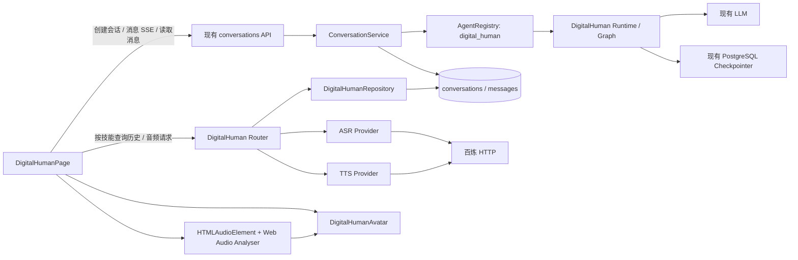
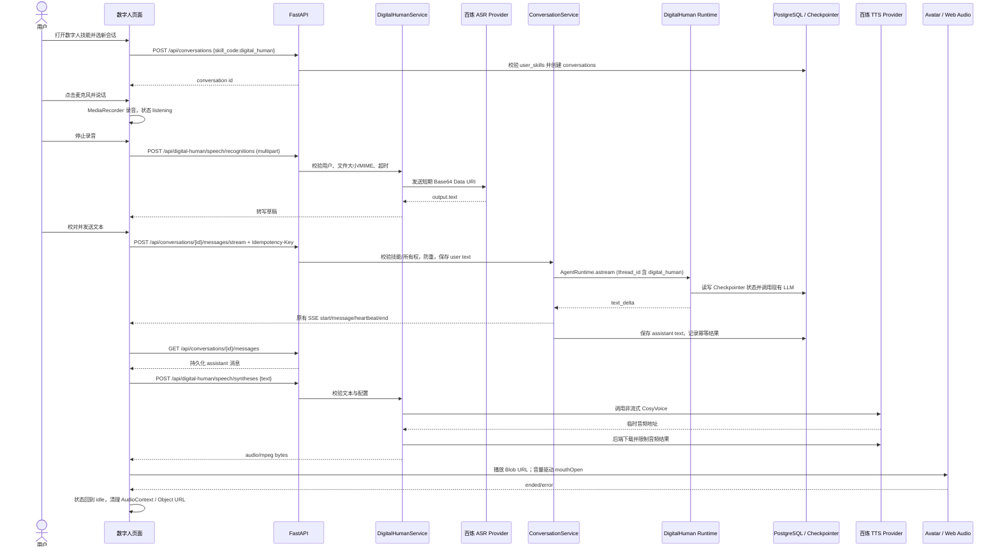

# 数字人智能体 MVP 实现方案

> 日期：2026-11-03  
> 状态：待审阅  
> 需求确认：范围已由需求说明确定；下文列出的技术选择作为非阻塞方案假设

## 1. 目标与背景

- **要解决的问题：** OrionAI 已有会话、消息、Agent Runtime、LangGraph Checkpointer 和 SSE 流式回答，但没有数字人专属业务入口、语音 Provider 或音频驱动的角色展示。
- **功能目标：** 增加独立数字人技能和交互页面，支持文字对话、录音转文字、回复语音合成、播放时嘴部跟随音量变化，并通过已有会话消息能力保留文字历史。
- **预期最终效果：** 用户从技能市场添加“数字人助手”后，可打开数字人页面；用户消息和助手文本继续保存到 `conversations` / `messages`，页面能只查看数字人会话；语音仅在请求和播放过程中短暂处理，不存入业务数据库或对象存储。

## 2. 已确认需求

- **使用者 / 调用方：** 已登录或访客身份用户；沿用现有 Cookie 认证、技能关联和会员准入行为。
- **触发方式：** 从技能市场添加数字人技能并从“我的技能”启动；页面可开始新会话或打开已有数字人会话。
- **输入：** 普通文本，或由浏览器麦克风录制的短音频。
- **输出：** 当前 SSE 协议中的助手文本增量；完成后可请求 TTS 并播放音频。ASR 文本在发送前显示为可编辑草稿。
- **主流程：**
  1. 应用启动时幂等注册 `digital_human` Agent 技能，并将其专属 Runtime 注册到现有 AgentRegistry。
  2. 用户经现有技能市场添加技能；页面通过现有会话创建接口，指定 `skill_code=digital_human`。
  3. 用户输入文本或录音；录音停止后上传数字人 ASR 接口，识别结果放入编辑框，用户确认后按普通文本消息发送。
  4. 现有会话 SSE 路由按会话技能分派数字人 Runtime，逐段发送文本增量，并按现有机制保存用户与助手文字消息。
  5. SSE 正常结束后，前端读取已保存的助手文本，请求 TTS；浏览器播放返回音频，并通过 Web Audio API 的音量分析驱动独立数字人组件的嘴部开合。
  6. 页面用数字人模块提供的过滤列表恢复历史会话，消息正文仍从现有消息接口读取。
- **业务规则与边界：** 一段时间只允许一个录音、ASR、对话流或 TTS 播放任务；麦克风单次录音时长限制为 30 秒；上传大小和 Provider 超时由后端限制；没有有效转写文本时不得创建用户消息；语音失败不丢失已经保存的文本消息。
- **异常行为：** 麦克风未授权或浏览器不支持 MediaRecorder 时显示可读错误；ASR、LLM、TTS 分别有独立失败提示和重试入口；LLM 流失败时沿用 SSE `end.status=failed` 语义；TTS 失败时仍保留文字答案并将角色状态复位。
- **权限与数据范围：** 新增语音和历史接口均基于 `CurrentUser`；会话创建、消息发送继续经过现有技能准入和会员依赖；历史查询仅返回当前用户且 `skill_code=digital_human` 的会话。
- **约束：** 不持久化录音和合成音频；ASR 转写作为普通 `user` 文本 part，助手回复作为普通 `assistant` 文本 part；不改现有 API SSE 事件封装；不增加数据库表或字段。

## 3. 范围

### 本次包含

- 独立 `digital_human` 后端模块，包含 Router、Service、Repository、Schemas、Agent 和 ASR/TTS Provider 适配层。
- 独立数字人 Agent Runtime / Graph / State；复用已有模型能力、AgentRuntime 契约、公共 Agent 节点能力和 PostgreSQL Checkpointer。
- 技能市场内建 Agent 技能注册及用户添加关系复用。
- 独立页面、数字人渲染组件、对话面板、录音与播放 Hook、历史列表和状态反馈。
- ASR、TTS 配置、异常映射、上传校验、超时限制和幂等发送保护。

### 本次不包含

- 实时双向语音、语音打断、边录边转写、流式语音合成、3D / Live2D、复杂表情或人物形象管理。
- 录音、合成音频、逐字时间戳或数字人状态的数据库持久化。
- 更换现有通用 Agent、会话表、消息协议、认证系统或前端全局导航结构。
- 新增数据库迁移、音频存储、任务队列、WebSocket 服务或大型前端音频依赖。

## 4. 需求澄清记录

需求说明已经指定用户、交互方式、数据持久化边界、Provider 层、UI 状态、非目标和输出范围；代码库提供了会话、技能与运行时实现依据，无需额外澄清即可形成可实施方案。以下是便于首版落地的非阻塞选择：

| 方案选择 | 建议值 | 对方案的影响 |
|---|---|---|
| 内建技能代码 | `digital_human`，类型 `agent` | 复用 skills / user_skills 权限和会话 `skill_code` 绑定 |
| ASR 模型 | `qwen-audio-3.1-asr-flash` 非流式 HTTP | 支持短音频 Base64 Data URI，服务端无需上传到可公开访问的存储 |
| TTS 模型 | `qwen-audio-3.1-tts-flash` 非流式 HTTP，音频格式 mp3 | 返回临时下载地址后由后端立即拉取并代理音频字节 |
| 语音大小 | 后端原始上传上限 7 MiB；TTS 响应上限 8 MiB | 固定在数字人模块代码中，不从环境变量覆盖 |
| 录音时长 | 前端单次录音最长 30 秒 | 浏览器录音到时自动停止；不引入音频解码依赖 |
| 识别后的发送 | 转写填入草稿，由用户确认发送 | 避免误识别直接触发 Agent 和消息持久化 |
| SSE 幂等键 | 数字人页面每轮生成 UUID，通过可选 `Idempotency-Key` 传递 | 复用 SSE 路由且避免双击、重复提交及传输重放造成重复执行 |

## 5. 当前代码结构与依据

| 现有文件 / 模块 | 当前职责 | 与本功能的关系 |
|---|---|---|
| `backend/app/modules/conversations/router.py` | 提供 `POST /api/conversations`、会话消息查询、同步发送和 `/messages/stream` SSE 路由 | 新页面复用会话创建、读取消息和流式发送，不复制会话 HTTP 协议 |
| `backend/app/modules/conversations/service.py` | `ConversationService` 校验会话所有权与技能、写用户消息、选择 Runtime、执行 Agent、保存助手消息；流式路径先保存用户消息，再在成功后保存助手回答 | 已满足数字人文字消息持久化和 Agent 执行的主体行为；需要可选幂等键保护 |
| `backend/app/modules/conversations/repository.py`、`models.py`、`schemas.py` | 会话和消息 CRUD；`Conversation.skill_code` 固定技能，`Message.content` 为 `parts` JSONB | 可直接复用；文本格式为 `{"parts":[{"type":"text","text":"..."}]}` |
| `backend/app/modules/skills/models.py`、`repository.py`、`service.py`、`router.py` | 技能目录和 `UserSkill` 关联；`GET /api/v1/skills` 查询市场，`POST /api/v1/users/me/skills` 添加当前用户技能 | 增加内建 Agent 技能目录项，不增加技能表或用户关系表 |
| `backend/app/agent/runtime/protocol.py`、`base_agent.py`、`graph.py`、`nodes/` | 定义 AgentRuntime；通用输入、工具、输出和文本流式事件能力 | 数字人独立 Runtime 可遵循既有契约并复用基础节点，不修改 general_chat Prompt 或编排 |
| `backend/app/modules/agents/registry.py`、`backend/app/core/application.py` | AgentRegistry 按技能代码调度；应用 lifespan 初始化模型、Checkpointer 和技能 | 注册数字人专属 Runtime，并在应用启动时幂等确保技能存在 |
| `backend/app/infrastructure/database/checkpointer.py`、`agent/memory/thread.py` | PostgreSQL LangGraph Checkpointer 连接生命周期；线程 ID 区分用户、技能、会话 | 继续复用单一 Checkpointer；数字人线程按 `digital_human` 隔离 |
| `backend/app/shared/streaming/response.py`、`events.py`、`encoder.py` | SSE 的 `start`、`message`、`heartbeat`、`end` 外壳；`message.data.type` 标识业务消息 | 原样复用；不在此协议中塞 Base64 音频，音频单独使用 HTTP 二进制响应 |
| `backend/app/core/config.py`、`.env.example` | Pydantic Settings / SecretStr 配置；已有百炼 API Key、Workspace OpenAI-compatible URL 和模型设置，当前被 memory training 使用 | 复用 API Key 与 Workspace 域名来源；语音模型、音色、超时和上限固定在数字人模块代码中，不把密钥送到前端 |
| `backend/pyproject.toml` | 当前依赖含 `httpx`、`python-multipart`、SQLAlchemy、LangGraph | ASR/TTS 可用现有 HTTP 和表单依赖；预期无需新增运行依赖 |
| `frontend/src/features/conversations/conversationApi.ts` | 同源 `/api` Cookie 请求、消息类型、SSE reader 和 `end` 状态检查 | 复用会话创建、消息读取和 SSE 消费逻辑；补充可选幂等请求头的传递 |
| `frontend/src/features/conversations/ConversationPage.tsx`、`conversations.css` | 通用对话页和消息呈现，内嵌 SSE、题卡与输入状态处理 | 参考消息与 SSE 行为；不将数字人状态、录音或音频播放逻辑并入通用聊天页 |
| `frontend/src/app/App.tsx`、`platformData.ts`、`skillUsage.ts`、`PlatformLayout.tsx` | 无 React Router；由 pathname 分派页面；技能启动路径在 `launchSkill` 中选择 | 新增专属 pathname 分支和技能启动分派，不新增或重排侧栏入口 |
| `frontend/src/features/conversations/ConversationHistory.tsx`、`SessionsPage.tsx` | 通用会话历史分页列表 | 数字人历史必须按技能过滤，不能从通用无过滤列表分页后在浏览器端过滤 |
| `frontend/src/styles/global.css`、`docs/design/UI_DESIGN.md` | 主题变量、控件基础样式和 Minimal Enterprise SaaS 规则 | 新页面沿用现有 tokens、按钮、焦点、状态和减少动态效果规范 |
| `backend/tests/integration/test_conversation_endpoints.py`、`test_skills_endpoints.py`、`frontend/src/features/conversations/` 下测试 | 现有会话、技能及前端测试组织 | 用于新增兼容性、权限、Provider 异常和页面交互测试 |

**现状结论：** 代码和架构文档中已有完整会话与 Agent 执行链路；README 概述中“对话尚未实现”的描述与当前实现及 `docs/architecture/overview.md` 不一致。实施应以当前代码、API 文档和专项架构文档为准，并可在后续维护 README 时单独校准。

### 当前请求与数据流

```text
React -> POST /api/conversations (skill_code)
      -> POST /api/conversations/{id}/messages/stream
      -> ConversationService 预检 / 保存 user 消息
      -> AgentRegistry[conversation.skill_code]
      -> AgentRuntime.astream -> 公共 SSE 封装 -> React
      -> Agent 完成后保存 assistant 消息 -> GET messages 读取历史
```

现有 SSE `message` 数据包含文本增量 `{"type":"text_delta","content":"..."}`，公共帧结构和心跳由 `create_sse_response` 管理。现有前端只把 `end.status=completed` 视为成功。故可以无协议变化地复用文本流；ASR 与 TTS 是独立 HTTP 调用，TTS 使用二进制音频响应。

## 6. 架构设计

### 模块职责与边界

| 模块 | 职责 | 依赖方向 / 边界 |
|---|---|---|
| `modules/digital_human/router/` | 暴露数字人历史列表和 ASR/TTS 端点；认证、来源校验、会员依赖、请求/响应类型 | Router -> DigitalHumanService；不执行模型调用或 SQL 拼装 |
| `modules/digital_human/service/` | 分页、输入边界、Provider 编排、错误转换和音频响应数据管理 | 依赖 Repo、Provider、现有认证用户和 Settings |
| `modules/digital_human/repository/` | 只查询当前用户且 `skill_code=digital_human` 的现有 Conversation 记录 | 依赖既有 SQLAlchemy `Conversation` 模型；不定义新模型或表 |
| `modules/digital_human/schemas/` | 转写文本、历史摘要、TTS 输入的 Pydantic 契约 | 不包含 Provider SDK 对象或 ORM 模型 |
| `modules/digital_human/agent/` | 专属 State、Graph 和符合 AgentRuntime 契约的 Runtime | 复用项目通用模型、工具/输入/输出基础设施与 Checkpointer；Prompt 独立 |
| `modules/digital_human/providers/` | ASR/TTS Provider 接口及百炼 HTTP 实现，隐藏认证、端点、模型 JSON 和错误细节 | `httpx.AsyncClient`；API Key 只由后端 Settings 注入 |
| `modules/conversations/` | 为 SSE 消息流增加可选幂等保护；其余会话语义和响应协议保持不变 | 不带幂等键的现有调用路径保持原行为；数字人每轮传 UUID |
| 前端 `features/digital-human/` | 专属页面、对话、录音、语音播放和独立 Avatar 渲染 | 调用数字人音频/历史接口及现有 conversation API |

### 数据与控制流



数字人 LLM 执行使用独立 Prompt、图配置和 `digital_human` thread ID，不调用或改动 `general_chat` 专属配置。Repo 查询使用现有表；ASR/TTS Provider 只处理请求字节、文本和返回音频，不持久化文件。

### 重复请求保护

数字人页面每次用户显式提交生成一个 UUID `Idempotency-Key`。会话 SSE 的可选幂等状态以 Redis 原子 `SET NX` 建立，Key 由用户 ID、会话 ID 和请求 UUID 组成，值记录请求文本摘要、执行状态和完成后的 assistant message ID，TTL 建议 24 小时。相同 Key 和请求内容正在处理时返回 409；已完成则根据保存的 assistant message 重放结果，不再写第二条消息或再次执行 Agent；相同 Key 用于不同请求文本返回 409。没有幂等头的既有调用不进入此逻辑。Redis 不可用时，对带幂等头的请求失败关闭并返回可识别服务错误，避免在数字人页面静默丢失防重语义。

## 7. 文件改动清单

以下是实施阶段的计划文件，不属于本次文档生成的实际变更。

| 文件路径 | 操作 | 职责 / 改动内容 | 放在此处的原因 |
|---|---|---|---|
| `backend/app/modules/digital_human/__init__.py` | 新增 | 声明数字人业务模块 | 模块包入口 |
| `backend/app/modules/digital_human/router/__init__.py`、`router/router.py` | 新增 | 历史、ASR、TTS Router | 符合用户要求的独立 Router 文件夹 |
| `backend/app/modules/digital_human/service/__init__.py`、`service/service.py`、`service/errors.py` | 新增 | 编排历史分页和 Provider 调用；集中模块错误 | 独立业务逻辑和错误边界，不在 Router 内调百炼 |
| `backend/app/modules/digital_human/repository/__init__.py`、`repository/repository.py` | 新增 | 查询数字人技能会话 | 复用 `Conversation` 模型，无新业务表 |
| `backend/app/modules/digital_human/schemas/__init__.py`、`schemas/schemas.py` | 新增 | 定义历史摘要、ASR 和 TTS 输入输出 | 独立 API DTO |
| `backend/app/modules/digital_human/agent/__init__.py`、`agent/runtime.py`、`agent/graph.py`、`agent/state.py`、`agent/prompts/system.md` | 新增 | 数字人独立 Runtime、图、状态、系统提示词 | 隔离数字人编排与通用助手行为 |
| `backend/app/modules/digital_human/providers/__init__.py`、`providers/asr.py`、`providers/tts.py` | 新增 | Provider 契约及百炼 ASR/TTS 适配 | 将供应商协议与业务服务隔离，便于替换 |
| `backend/app/modules/digital_human/dependencies/__init__.py`、`dependencies/dependencies.py` | 新增 | 注入数据库、Settings、Provider 和 Service | 遵循 FastAPI Depends，保持 Router 薄 |
| `backend/app/modules/skills/repository.py` | 修改 | 增加幂等注册 `digital_human` 已发布 Agent 技能的方法 | 技能目录由现有 skills 模块拥有；只增加一条定义，不改通用技能行为 |
| `backend/app/core/application.py` | 修改 | 生命周期注册数字人技能、构造专属 Runtime 并添加 AgentRegistry；注册数字人领域错误响应映射 | 符合现有组合根集中组装 Agent 和异常处理的方式 |
| `backend/app/api/router.py` | 修改 | 聚合数字人 Router | 保持模块路由集中注册 |
| `backend/app/modules/digital_human/constants.py` | 新增 | 固定语音模型、音色、超时、音频字节/文本上限；不增加语音环境变量 | 阿里云密钥仍复用 `Settings` 中的 SecretStr |
| `backend/app/modules/conversations/router.py` | 修改 | 为普通消息 SSE 接受可选 `Idempotency-Key` | 只给主动选择该能力的客户端增加防重；原请求体和 SSE 格式不变 |
| `backend/app/modules/conversations/dependencies.py` | 修改 | 为带幂等头的请求注入既有 Redis 客户端/幂等存储 | 复用现有 Redis 基础设施 |
| `backend/app/modules/conversations/service.py` | 修改 | 处理幂等状态预留、完成记录、重复请求冲突/重放；不改变无头请求逻辑 | 保障重复请求不重复持久化或调用 Runtime |
| `frontend/src/features/digital-human/DigitalHumanPage.tsx`、`digitalHuman.css` | 新增 | 专属页面布局、对话、语音和状态展示 | 独立功能页面，不污染通用 ConversationPage |
| `frontend/src/features/digital-human/digitalHumanApi.ts`、`types.ts` | 新增 | 数字人历史、ASR、TTS API 及 DTO | 将新 HTTP 契约与会话 API 客户端分开 |
| `frontend/src/features/digital-human/hooks/useMicrophoneRecorder.ts`、`useAssistantAudio.ts` | 新增 | MediaRecorder 生命周期、音频 URL、Web Audio 音量分析和清理 | 使音频行为与页面和渲染组件解耦 |
| `frontend/src/features/digital-human/components/DigitalHumanAvatar.tsx`、`DigitalHumanConversation.tsx`、`DigitalHumanComposer.tsx` | 新增 | 可替换 Avatar；数字人消息区和文本/麦克风输入 | 渲染和 Agent 对话职责分离 |
| `frontend/src/features/conversations/conversationApi.ts` | 修改 | 为 SSE 请求可选透传 Idempotency-Key；保留现有 parser 和事件模型 | 数字人使用同一 SSE 协议和会话接口 |
| `frontend/src/features/platform/platformData.ts` | 修改 | 增加数字人 pathname 及带会话 ID 的类型判断 | 现有页面路由集中管理 |
| `frontend/src/features/platform/skillUsage.ts` | 修改 | 将 `digital_human` 分派到数字人入口并创建其新会话 | 复用技能启动流程和会员检查 |
| `frontend/src/app/App.tsx` | 修改 | 增加数字人页面路由分派并解析数字人会话 ID | 当前 pathname 路由组合根 |
| `frontend/src/features/platform/PlatformLayout.tsx` | 修改 | 对数字人页应用合适的内容布局并展示页面标题 | 延续应用壳层和当前侧栏结构 |
| `backend/tests/unit/test_digital_human_providers.py`、`test_digital_human_agent.py`、`test_digital_human_repository.py` | 新增 | Provider 错误、Runtime 契约和历史隔离测试 | 覆盖独立后端模块边界 |
| `backend/tests/integration/test_digital_human_endpoints.py`、既有 `test_conversation_endpoints.py` | 新增 / 修改 | 新路由权限、限制、数据库复用、SSE 防重及兼容性回归 | 验证接入点和数据行为 |
| `frontend/src/features/digital-human/*.test.tsx`、`*.test.ts` | 新增 | 状态、录音权限失败、转写发送、TTS 播放和清理测试 | 覆盖页面与浏览器 API 适配 |

## 8. 目标代码结构

```text
backend/app/modules/digital_human/                 # 新增
├── __init__.py
├── router/
│   ├── __init__.py
│   └── router.py
├── service/
│   ├── __init__.py
│   ├── errors.py
│   └── service.py
├── repository/
│   ├── __init__.py
│   └── repository.py
├── schemas/
│   ├── __init__.py
│   └── schemas.py
├── agent/
│   ├── __init__.py
│   ├── graph.py
│   ├── runtime.py
│   ├── state.py
│   └── prompts/
│       └── system.md
├── providers/
│   ├── __init__.py
│   ├── asr.py
│   └── tts.py
└── dependencies/
    ├── __init__.py
    └── dependencies.py

frontend/src/features/digital-human/               # 新增
├── DigitalHumanPage.tsx
├── digitalHuman.css
├── digitalHumanApi.ts
├── types.ts
├── components/
│   ├── DigitalHumanAvatar.tsx
│   ├── DigitalHumanComposer.tsx
│   └── DigitalHumanConversation.tsx
└── hooks/
    ├── useAssistantAudio.ts
    └── useMicrophoneRecorder.ts

backend/app/modules/skills/repository.py            # 修改：注册 digital_human Skill
backend/app/core/application.py                     # 修改：注册数字人 Runtime
backend/app/api/router.py                           # 修改：聚合数字人 Router
backend/app/core/config.py                          # 修改：语音设置
backend/app/modules/conversations/{router,dependencies,service}.py  # 修改：可选防重
frontend/src/features/conversations/conversationApi.ts              # 修改：透传幂等键
frontend/src/features/platform/platformData.ts       # 修改：新路径类型
frontend/src/features/platform/skillUsage.ts         # 修改：技能启动分派
frontend/src/features/platform/PlatformLayout.tsx    # 修改：页面标题/布局标记
frontend/src/app/App.tsx                             # 修改：页面路由
```

`digital_human` 中 Router、Service、Repository、Schemas、Agent、Providers 和 Dependencies 均各自处于目录内；不在模块根目录放置单个业务 Python 文件。UI 不修改现有五个全局导航入口的结构或次序；从技能使用入口和数字人页内历史导航到达该页面。

## 9. 接口与数据库变更审查

### 接口影响

| 接口（方法 + 路径 / 事件） | 操作 | 当前定义位置 | 变更前后契约 | 复用判断与变更理由 | 兼容性 / 调用方影响 |
|---|---|---|---|---|---|
| `GET /api/v1/skills`、`POST /api/v1/users/me/skills` | 保持不变 | `modules/skills/router.py` | 原技能市场与添加契约不变；新发布技能由市场自动展示 | 复用技能目录、用户技能关联和授权 | 已有调用不变 |
| `POST /api/conversations` | 保持不变 | `modules/conversations/router.py` | 请求 `{skill_code:"digital_human"}`；返回现有 ConversationCreateResponse | 复用会话创建和技能校验 | 已有请求不变；用户需已添加数字人技能 |
| `GET /api/digital-human/conversations?limit&offset` | 新增 | `digital_human/router/router.py` | 返回当前用户的数字人会话摘要、分页信息；不返回其他技能会话 | 通用 `GET /api/conversations` 不支持 skill filter；前端过滤会漏掉跨页记录，故由数字人模块提供严格过滤列表 | 新路径，仅新页面使用 |
| `GET /api/conversations/{conversation_id}/messages?limit&offset` | 保持不变 | `modules/conversations/router.py` | 继续返回当前用户会话消息和 `skill_code`；前端校验 skill_code 为 `digital_human` | 复用消息分页与所有权校验 | 不改变既有调用 |
| `POST /api/conversations/{conversation_id}/messages/stream` | 可选头扩展 | `modules/conversations/router.py`、`service.py` | 请求体和 SSE 契约不变；数字人传 `Idempotency-Key: <UUID>`。同键处理中 409；完成后重放已持久化结果；不带头请求走当前行为 | 当前 SSE 已满足文本流，不需另建协议；现接口缺少请求去重，增加可选键以满足防重 NFR | 现有客户端不带头时兼容；数字人客户端必须带头并在同一次发送重试中复用该键 |
| `POST /api/digital-human/speech/recognitions` | 新增 | `digital_human/router/router.py` | `multipart/form-data` 字段 `file`；成功返回 `{text}`；空转写受控验证错误；超限 413、格式错误 422、Provider 不可用 503 | 共享 SSE 无法接收上传音频；Provider 适配必须由后端执行 | 仅新页面调用；需要 Cookie 认证、Origin 校验和会员准入 |
| `POST /api/digital-human/speech/syntheses` | 新增 | `digital_human/router/router.py` | JSON `{text}`；成功返回 `audio/mpeg` 二进制，带 `Cache-Control: no-store`；校验失败 422、超时/上游失败 503 | SSE JSON envelope 不是音频传输协议；避免改 SSE 或泄漏百炼临时 URL | 仅新页面调用；浏览器创建临时 Blob URL 并在播放后释放 |
| `/api/digital-human/*` | 新增认证保护 | 新模块依赖 | 使用 `CurrentUser`、`validate_origin` 和现有会员依赖；错误不包含密钥、上游响应全文或堆栈 | 沿用已有认证、来源校验和会员机制 | 未登录、未授权或无会员时沿用一致错误状态 |

### 数据库影响

| 表 / 字段 | 操作 | 当前定义位置 | 用途与需求依据 | 复用判断与新增理由 | 迁移 / 回填 / 默认值 / 回滚 |
|---|---|---|---|---|---|
| `skills.code/name/type/status` | 复用；增加一条 `digital_human` Agent 种子数据 | `modules/skills/models.py`、技能注册函数 | 会话绑定独立数字人 Agent，用户可从市场添加 | 现有技能目录已经提供发布、禁用和类型校验能力 | 无表结构迁移；启动时幂等 upsert |
| `user_skills.user_id/skill_id/skill_name` | 不变 | `modules/skills/models.py` | 沿用当前用户添加技能关系 | 已满足权限边界 | 无迁移；使用现有添加接口 |
| `conversations.id/user_id/skill_code/title/created_at/updated_at` | 不变；增加普通会话记录 | `modules/conversations/models.py` | 按 `skill_code=digital_human` 区分数字人会话 | 无须新建数字人会话实体；现有 `skill_code` 外键适用 | 无迁移；新建会话通过现有 service |
| `messages.id/conversation_id/role/content/created_at` | 不变；保存普通文本消息 | `modules/conversations/models.py` | 用户转写作为普通 `user` text part，LLM 回复为 `assistant` text part | 现有 JSONB `parts` 已支持文本；不需 audio 类型或新列 | 无迁移；不存录音、音频 URL 或音频字节 |
| LangGraph Checkpointer 内部表 | 复用 | `infrastructure/database/checkpointer.py` | 保存 Agent 图状态并按用户、技能、会话隔离 | 由现有 PostgreSQL Checkpointer 管理，无业务表需求 | 不新增 Alembic 迁移；延用现有 setup |
| Redis 幂等状态键（非数据库表） | 新增短期键 | 现有 Redis 客户端基础设施 | 保存请求摘要、执行状态和 assistant message ID，避免 SSE 请求重放 | 现有消息表没有客户端 turn key；新增数据库列/表不符合最小化需求 | TTL 24 小时；自然过期；不影响业务数据恢复 |

**数据库结论：不新增或修改任何数据库表、字段、索引或迁移。** 数字人历史靠现有 `skill_code` 过滤；录音与合成音频不持久化；图执行状态继续使用既有 Checkpointer 专用数据库。

### 最小变更结论

- **可复用：** 会话创建、消息分页、SSE 帧协议、技能市场和用户技能关联、用户认证、会员准入、LLM 客户端、LangGraph Checkpointer、数据库模型、Redis 客户端、前端主题和通用页面壳。
- **新增最小集合：** 数字人业务包和页面；数字人技能注册与 AgentRegistry 装配；ASR/TTS HTTP Provider 与两个语音端点；一个技能过滤历史列表；SSE 可选幂等头及 Redis 防重状态；独立 Avatar/录音/播放代码。
- **排除的冗余设计：** 不复制 `Conversation`/`Message` ORM，不新建 audio/message/conversation 表，不将音频放入现有 SSE，不引入 OSS、Celery、WebSocket、前端音频库或 3D SDK。
- **尚未确认的阻塞决策：** 无。模型、音色、录音限制和转写确认流程均可配置或按文内建议实施。

## 10. 阿里云百炼 ASR / TTS 接入方案

### ASR Provider

- `providers/asr.py` 定义 ASR Provider 协议和百炼实现。业务 Service 只调用 `transcribe(audio_bytes, content_type)`，不拼装供应商 JSON。
- 默认模型建议 `qwen-audio-3.1-asr-flash` 非流式 HTTP。官方接口为工作空间域名下的 `/api/v1/services/aigc/multimodal-generation/generation`，输入支持音频 URL 或 Base64 Data URI；成功结果从 `output.text` 读取。参见[Qwen-Audio-ASR HTTP API](https://help.aliyun.com/zh/model-studio/qwen-audio-asr-http-api)。
- 浏览器优先使用受支持的 MediaRecorder MIME 类型；后端依据真实 `Content-Type` 映射为 MIME Data URI 和音频格式，不把用户提供的任意 MIME 原样作为外部 URL 或任意文件类型。
- 后端以受限大小读取上传、在请求生命周期内持有 bytes，向百炼发送 Base64 Data URI；不创建 OSS 对象、不落业务文件、不记录音频/Base64。设置最大原始字节 7 MiB、ASR 请求超时例如 60 秒；在 Provider/Settings 中配置，测试可注入 Mock HTTP transport。
- 前端单次录音上限为 30 秒；请求体仍由后端限制，避免超大 multipart 在解析阶段占用过多资源。ASR 失败、无语音、空文本、超时、限流和无效上游 JSON 转为稳定模块错误，不向客户端透传 Authorization 或完整上游 body。

### TTS Provider

- `providers/tts.py` 定义 `synthesize(text) -> bytes`；使用 `qwen-audio-3.1-tts-flash` 非流式生成 mp3，音色 ID 固定在数字人模块代码中。`longanyang` 属于 CosyVoice，不能与 Qwen-Audio 3.1 混用；为保持男性普通话音色，使用 Qwen 支持的 `xunanchuan_v3.1`。官方 HTTP 请求使用百炼工作空间专属域名和 `SpeechSynthesizer` API，响应提供临时 `output.audio.url`。参见[Qwen-Audio-TTS HTTP API](https://help.aliyun.com/zh/model-studio/qwen-audio-tts-http-api)和[Qwen-Audio-TTS 音色列表](https://help.aliyun.com/zh/model-studio/qwen-audio-tts-voice-list)。
- 由于临时 URL 有效期有限且可能跨域，不将其返回浏览器；后端在超时和大小限制内下载音频，再以 `audio/mpeg` 响应。仅接受预期 HTTPS 百炼/OSS 结果域名，避免将上游返回 URL 当作任意地址访问；限制 TTS 文本长度和结果字节数。
- 使用 `httpx.AsyncClient` 异步请求，分离模型请求和音频下载超时；Provider API Key 仅通过 `Settings.aliyun_bailian_api_key` 的 SecretStr 获取，模型 ID、音色、超时和上限是数字人模块内的代码常量。
- 已存在的 `ALIYUN_BAILIAN_BASE_URL` 是 OpenAI-compatible URL。Provider 应从已校验 URL 取得工作空间域名 origin，再拼接官方语音路径；不得直接在 `.../compatible-mode/v1` 后拼接造成错误路径。语音参数不增加到 `.env.example`，百炼 API Key 仍由后端环境变量提供。

## 11. 数字人动画与前端交互方案

### 页面结构

- 页面主区域使用轻量双栏或窄屏纵向布局：一侧数字人展示和状态说明，另一侧消息列表、文本框与麦克风控件；历史会话使用本页列表或轻量侧栏，不改全局侧栏。
- `DigitalHumanAvatar` 接收 `{status, mouthOpen}`，不读麦克风、不请求 API、不依赖 Agent 类型。首版使用 SVG/HTML/CSS 绘制简洁 2D 角色；`mouthOpen` 归一化为 0–1，调整嘴部形状/高度。
- 页面遵循 `UI_DESIGN.md`：浅色中性表面、现有主题 token、公共按钮、明确焦点、加载/空/错误文案、移动端布局和 `prefers-reduced-motion`。

### 状态机

| 状态 | 进入时机 | 呈现 |
|---|---|---|
| `idle` | 初始、完成/失败、停止播放 | 静止待机；嘴部闭合 |
| `listening` | MediaRecorder 开始录音 | 轻量听取反馈；嘴部闭合；显示停止录音按钮 |
| `thinking` | ASR 请求、LLM SSE 或 TTS 准备阶段 | 不做嘴部动作；通过文字状态提示处理中 |
| `speaking` | `<audio>` 正在播放助手音频 | Web Audio 分析播放电平，更新 `mouthOpen` |

状态转换：`idle -> listening -> thinking(ASR) -> idle(转写草稿) -> thinking(LLM) -> thinking(TTS) -> speaking -> idle`。TTS 失败时 `thinking -> idle` 并保留完整文字；用户取消录音则回 `idle`，不会创建消息。

### 音量分析和资源清理

`useAssistantAudio` 为音频元素创建 `MediaElementAudioSourceNode -> AnalyserNode -> AudioContext.destination` 链，在 `requestAnimationFrame` 中采样时域数据并计算 RMS/平滑包络，映射到 mouthOpen。音频结束、错误、页面切换或卸载时取消帧循环，解绑监听，关闭 AudioContext，撤销 Object URL。使用同一 `<audio>` 元素避免重复创建 MediaElementSource。麦克风录制仅由 `MediaRecorder` 获取 Blob；停止录音立即停止所有 MediaStreamTrack。

### 播放规则

- TTS 仅对最终持久化的 assistant 文本调用；从 SSE 正常完成后读取消息列表，提取最后一条 assistant `text` part，避免播放未完成的部分输出或题卡。
- 通过 `URL.createObjectURL` 播放 TTS 返回的 mp3。正文文本先做适度 Markdown 语法清理；合成失败仍允许读文本。历史消息默认不自动合成，避免打开历史时意外播放；若增加单条“播放”动作，复用同一 TTS 请求和 Hook。
- 浏览器播放若被自动播放策略拒绝，则显示可聚焦的“播放语音”操作并保持 `idle`，由用户手势启动。

## 12. 完整交互时序



文字输入流程从“校对并发送文本”开始；它与 ASR 流程之后的对话处理相同。用户转写只在普通会话 SSE 提交时保存一次。

## 13. 开发任务拆分与实施顺序

### 步骤 1：建立数字人 Agent 技能和 Runtime

- **文件：** `skills/repository.py`、`core/application.py`、`modules/digital_human/agent/**`、`api/router.py`。
- **工作：** 幂等注册 `digital_human` Skill；按现有 Runtime 协议创建独立 Prompt/Graph/State/Runtime；向 AgentRegistry 装配；聚合 Router。
- **前置依赖：** 无。
- **验收标准：**
  - [ ] 初始化后技能市场可查询到唯一的已发布 `digital_human` Agent 技能。
  - [ ] 使用该技能创建的会话由数字人 Runtime 响应；`general_chat` 仍由原 Runtime 响应。
  - [ ] LangGraph thread ID 包含用户、`digital_human` 和会话维度。
- **验证方式：** 技能注册幂等测试、AgentRegistry 装配测试、Runtime invoke/astream 契约测试。

### 步骤 2：增加 ASR/TTS 配置、Provider 和语音接口

- **文件：** `core/config.py`、`.env.example`、`digital_human/providers/**`、`service/**`、`schemas/**`、`dependencies/**`、`router/**`、`api/router.py`、`core/application.py`（错误处理注册如需要）。
- **工作：** 增加模型/音色/字节限制/超时配置；实现百炼 Provider；通过 FastAPI 依赖注入；实现 multipart ASR 和二进制 TTS；映射可控错误；TTS 音频立即代理、不缓存。
- **前置依赖：** 步骤 1 的模块和路由注册。
- **验收标准：**
  - [ ] 配置无效或缺失时应用仍可启动，语音请求返回稳定服务错误，不泄漏密钥。
  - [ ] ASR 可将受支持的短录音转换为文本，超限/不支持类型/超时分别返回明确状态码。
  - [ ] TTS 返回可播放 `audio/mpeg`，不向浏览器返回百炼 API Key 或临时 URL，不写数据库或 OSS。
- **验证方式：** Mock 百炼成功、超时、限流、畸形 JSON、下载 URL 非法、大小超限和空转写的 Provider/API 测试；配置 Settings 单测。

### 步骤 3：实现数字人历史过滤和消息防重

- **文件：** `digital_human/repository/repository.py`、`service/service.py`、`router/router.py`，`conversations/router.py`、`dependencies.py`、`service.py`。
- **工作：** 新增仅返回当前用户数字人会话的分页查询；让通用 SSE 可选接收幂等键，并通过 Redis 原子状态防重和已完成结果重放；没有幂等头时维持原有分支。
- **前置依赖：** 步骤 1。
- **验收标准：**
  - [ ] 列表只返回当前用户 `skill_code=digital_human` 会话，排序、分页和总数准确。
  - [ ] 并发发送相同 Key 不会第二次写入 user message 或执行 Agent；完成后的相同请求重放原 assistant message。
  - [ ] 相同 Key 携带不同文本得到 409；不带 Key 的现有通用请求在原测试契约下继续通过。
- **验证方式：** Repository 用户/技能隔离单测；Redis 集成测试覆盖同键并发、完成重放、冲突、过期与 Redis 错误关闭。

### 步骤 4：实现数字人页面和路由入口

- **文件：** `frontend/src/features/digital-human/**`、`features/conversations/conversationApi.ts`、`features/platform/platformData.ts`、`skillUsage.ts`、`PlatformLayout.tsx`、`app/App.tsx`。
- **工作：** 新增专属页面和内聚的 Hook/组件；支持历史选择、创建会话、消息流、转写草稿、录音错误、TTS 播放和四态展示；通过技能启动入口到达页面；确保每次 SSE 提交带幂等 UUID。
- **前置依赖：** 步骤 1–3 的后端接口。
- **验收标准：**
  - [ ] 用户可创建/打开数字人会话，文字和转写文本使用现有 SSE 与消息数据格式。
  - [ ] 页面历史只展示数字人会话；路由打开不属于当前用户/非数字人会话时给出安全错误。
  - [ ] 麦克风状态经过 `idle/listening/thinking`；播放语音进入 `speaking`，嘴部随音量变化并在结束后回到 `idle`。
  - [ ] 浏览器不支持或未授权麦克风、ASR 失败、SSE 失败、TTS 失败和播放被拒绝均可恢复，不丢失已保存文本。
  - [ ] 320px 窄屏可操作，键盘焦点可见，系统减少动态效果时移除非必要动画。
- **验证方式：** React 测试替身覆盖 MediaRecorder、AudioContext、HTMLMediaElement；人工在 Chrome/Edge 录音、播放及移动尺寸检查。

### 步骤 5：回归检查并记录部署配置

- **文件：** 后端/前端新增测试和关联既有测试；`.env.example`。
- **工作：** 验证认证、会员、技能准入、普通会话、图片/简历等其他 Agent 的路由和 SSE 不回归；记录百炼密钥、区域 Workspace 域名及启用模型的部署要求。
- **前置依赖：** 步骤 1–4。
- **验收标准：**
  - [ ] 数据库模型 diff 为零，不生成或执行 Alembic 迁移。
  - [ ] 全部新增验证通过，现有 conversation、skills、Agent、应用 lifespan 和前端会话测试通过。
  - [ ] 前端 bundle 不含百炼密钥；服务日志不记录音频/Base64/Authorization。
- **验证方式：** 运行相关后端 pytest、ruff 和前端 typecheck/lint/test/build；检查迁移状态、网络请求与服务日志。实施阶段执行并记录结果。

## 14. 测试方案和验收标准

| 验收点 | 验证类型 | 建议位置 / 方法 | 通过条件 |
|---|---|---|---|
| 数字人技能注册及用户关联 | 单元 + 集成 | `test_skills_endpoints.py`、数字人注册测试 | 重复启动不创建重复技能；仅已添加且发布技能可创建会话 |
| Agent 隔离及 Checkpointer | 单元 | `test_digital_human_agent.py`、应用 lifespan 测试 | `digital_human` 使用自身 Prompt/thread；general_chat 的 Agent 映射与回复路径不改变 |
| ASR 请求校验与解析 | Provider 单元 + API 集成 | Fake HTTP transport / `test_digital_human_endpoints.py` | 有效短音频返回识别文本；空结果和异常上游不泄密 |
| ASR 上传边界 | API 边界 | 超大文件、MIME 不匹配、空文件、时长上限 | 超限不调用 Provider；错误码和提示稳定 |
| TTS 请求与音频代理 | Provider 单元 + API 集成 | Mock 模型响应及临时 URL 下载 | 响应是音频字节；非 HTTPS/非允许域、超时、非音频、过大结果均拒绝 |
| 会话和消息持久化 | 集成 | 现有 conversation endpoints 测试扩展 | ASR 文本发送后仅有一条普通 user 文本消息；assistant 文本持久化；无音频字段 |
| 历史列表隔离 | Repository + API | 两个用户、两种 skill 的夹具 | 仅返回请求用户的 digital_human 会话，分页 total 正确 |
| SSE 协议兼容 | 集成 + 前端 | 现有 SSE endpoint/parser 测试 | `start/message/heartbeat/end` 和 `text_delta` 契约不变，失败 end 可识别 |
| 重复执行保护 | Redis 并发集成 | 相同 Key 并发/重复完成/正文变化/Redis 不可用 | 相同 Key 不重复执行或创建消息；不同正文 409；原调用不带 Key 的行为不变 |
| UI 状态和口型 | 组件/Hook + 人工 | Mock Web APIs；真实音频检查 | Avatar props 状态准确；RMS 有平滑开合；结束/异常/卸载后释放 MediaStreamTrack、AudioContext 和 Object URL |
| 安全与配置 | 静态检查 + 人工检查 | build 文件、配置和日志 | 浏览器源代码无 Key；没有音频/Base64 日志；Origin、认证和会员依赖有效 |
| 页面样式和可访问性 | 手工 + 组件测试 | 桌面、320px、键盘和 reduced-motion | 令牌一致，无新增导航项，控件具备名称、焦点和状态文案 |
| 数据库兼容 | Schema 检查 | ORM metadata / Alembic revision 状态 | 不新增表、列、索引或迁移；存量通用会话仍可读取 |

### 验收定义

1. 用户能从添加数字人技能后的使用入口进入页面，发送文字并看到流式助手回答。
2. 用户能录制不超过限制的语音，看到转写结果，确认后以普通文本发送；用户和助手文本可在历史记录中重新加载。
3. 完成回答能通过百炼 TTS 播放；播放过程嘴部随音量开合，音频结束后复位。
4. 数字人历史只显示当前用户数字人技能会话；会话和消息均受现有用户所有权验证。
5. ASR/TTS 超时、限额、授权和上游异常得到可读反馈；音频不落库、不进 OSS、不进业务日志。
6. SSE 协议、通用助手默认路径、既有表结构和 Alembic 版本不变；数字人主动传相同幂等键时不会重复运行同一轮。

## 15. 后续扩展设计

- **更换供应商：** 保持 `ASRProvider` / `TTSProvider` 内部契约，增加其他 Provider 实现并由 Settings/依赖注入切换，不改变 Service、页面或消息表。
- **实时语音：** 后续若做边录边识别或流式 TTS，新增 WebSocket / 专用流式 Provider 和协议；不要把音频帧编码混入当前通用聊天 SSE。
- **更丰富的口型：** 将 `DigitalHumanAvatar` 的 `mouthOpen` 扩展为音素/viseme 输入或 Adapter 接口，当前播放器音量分析可被 Live2D/3D 驱动替换。
- **多个数字人与声音：** 增加服务端受控 persona/voice 配置和授权校验；只有确认需要用户管理时再评估业务表或配置实体。
- **音频历史：** 只有产品明确需要回放、保留期限、删除和隐私策略后，再评估私有对象存储与媒体元数据；本 MVP 不建立迁移基础。
- **SSE 防重演进：** 当前 Redis 状态短期保存请求摘要与消息引用；若未来要求跨 Redis 失效恢复或审计，可评估将幂等键写入独立消息元数据，但需新的数据需求和迁移决策。

## 16. 风险、假设与运行考虑

- **百炼 Workspace URL：** 现有环境变量配置的是 OpenAI-compatible 路径。实施时必须从已校验 URL 取 origin，并确保 API Key 所属地域和 Workspace 一致；不能在 OpenAI-compatible 路径下误拼接语音端点。
- **音频格式差异：** 浏览器 MediaRecorder 的 MIME 能力因浏览器不同；实现要检测支持列表，服务端显式允许格式，对不兼容的浏览器给出说明。首版以 Chromium 类现代浏览器为主要验证目标。
- **非实时延迟：** ASR、LLM、TTS 顺序执行会比纯文本慢；`thinking` 状态和独立超时让用户看见进度，MVP 不承诺实时语音延迟。
- **TTS URL 安全：** 百炼返回临时下载链接，必须只允许 HTTPS 且 host 符合受控阿里云结果域规则；下载大小和时间均有上限，避免 SSRF 和资源消耗。
- **SSE 持久化语义：** 当前对话 Service 先持久化用户消息，Agent 成功后再持久化助手消息；失败时用户消息保留，未完成的增量不作为最终助手历史。幂等状态必须正确处理失败、断连和消息已保存后的重放。
- **访客限制：** 使用现有 `CurrentUser` 可兼容访客 User；会员准入依赖继续决定能否创建/发送会话。数字人历史列表只检查用户所有权，不提升其他资源权限。
- **外部请求和日志：** 对语音上传使用请求体字节上限和总超时；禁止记录音频字节、转写全文、密钥和上游响应原文。若记录诊断日志，仅记录 request id、耗时、结果状态和错误类别。
- **配置假设：** 已有百炼 API Key 和 Workspace 设置可用于启用语音模型；若部署账户尚未开通 ASR/TTS，应用仍可提供文本对话，语音接口返回受控的未配置错误。
- **发布与回滚：** 无数据库迁移；可先部署代码和配置，再发布 `digital_human` 技能。回滚时禁用技能并撤销新入口即可；已创建会话/消息继续由现有数据模型读取，不需删除或转换。

## 完成定义

- [ ] 文档中的目标结构、API 和数据库影响与实施提交一致。
- [ ] 数字人模块与通用 Agent 行为保持隔离，语音 Provider 不泄漏密钥或音频。
- [ ] 本文列出的单元、集成、前端和兼容性检查均执行并记录真实结果。
- [ ] 未新增业务表、字段或迁移；未实现的后续能力仍保持在范围之外。
